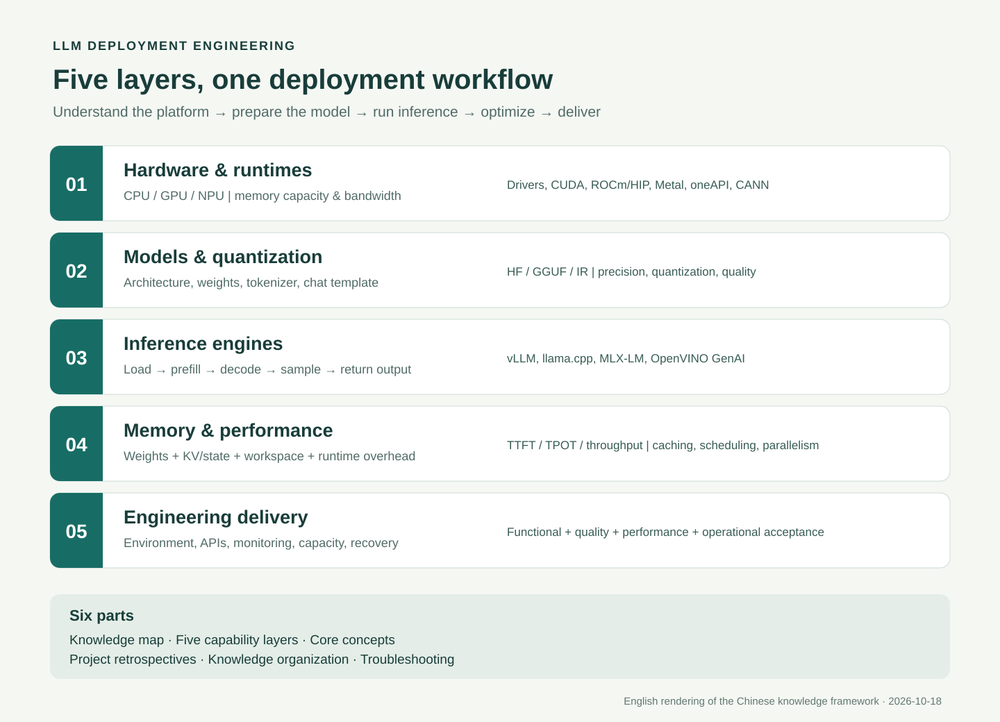

# LLM Deployment Knowledge Base

[简体中文](README.md) | **English**



A practical knowledge base for deployment engineers, covering hardware and runtimes, models and quantization, inference engines, performance optimization, and service delivery. Start with the role of each software layer and the inference execution path, then move on to platform configuration and engineering examples.

## Start here

| Content | Entry point | What it covers |
| --- | --- | --- |
| **Knowledge base** | [LLM deployment foundations](docs/en/README.md) | Hardware and software fundamentals, five capability layers, and technical topics |
| Hardware and runtimes | [CPUs, GPUs, NPUs, and the software stack](docs/en/02-capability-layers/01-hardware-backends.md) | Drivers, runtimes, compute libraries, and backend selection |
| Full contents | [Five-layer contents](docs/en/SUMMARY.md) | Hardware, models, frameworks, performance, and delivery |
| Hardware examples | [GPU, NPU, and Apple platform matrix](docs/en/engineering/README.md) | Adaptation, baselines, optimization, results, and limitations |
| Standalone cases | [Case directory](cases/README.en.md) | Tutorials, scripts, inputs, screenshots, and results kept with each project |
| CPU walkthrough | [Run a complete inference service](docs/en/practice/first-service/README.md) | Artifact verification, API requests, load testing, and acceptance checks |

## Scope

- Five engineering layers: hardware and runtimes; model formats and quantization; inference frameworks; memory and performance; engineering delivery.
- Platform fundamentals: [NVIDIA and CUDA](docs/en/chapters/hardware/nvidia.md), [AMD and ROCm](docs/en/chapters/hardware/amd.md), [Mac, Metal, and MLX](docs/en/chapters/hardware/apple.md), [Intel and OpenVINO](docs/en/chapters/hardware/intel.md), and [Ascend and CANN](docs/en/chapters/hardware/ascend.md).
- Hardware examples document environments, model artifacts, launch parameters, baselines, optimization experiments, measured performance, failures, and acceptance boundaries.
- Public technical records collected from FlowUs are included with the relevant examples. Private paths, account details, credentials, and internal addresses have been removed.

## Get the repository

```bash
git clone https://github.com/qiyuefffs/llm-deployment-engineering.git
cd llm-deployment-engineering
```

Read the English Markdown pages directly on GitHub. The Chinese edition also provides a downloadable single-file offline reader at `docs/01-deployment-foundations/book.html`. Model weights, caches, and private runtime logs are not included in the repository.

The English edition shares executable code, input files, measurements, and screenshots with the Chinese edition. Original Chinese prompts, expected responses, code comments, and log excerpts are retained where they are part of the reproducible material.

## Evidence status

The CPU walkthrough includes public results from an actual run. GPU, NPU, and multi-node records retain their original test conditions and identify historical tests, missing evidence, and unverified items. Their performance figures are not guarantees for another device or environment. The MUSA page provides an adaptation and validation procedure; device measurements are still pending.

Source edition updated: **2026-10-18**.
