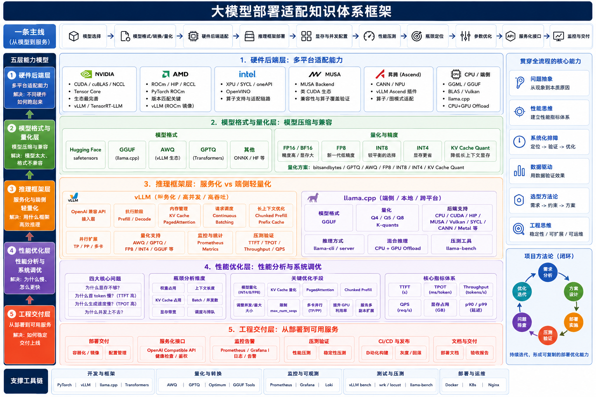

# 端侧大模型部署适配与推理优化：知识体系与实战

围绕一条工程主线学习：明确需求 → 确认兼容 → 跑通服务 → 测量性能 → 定位优化 → 验收交付。

面向大模型部署、推理优化和多硬件适配工程师。知识体系从端侧约束与请求链路开始，完整展开硬件兼容、模型量化、内存预算、llama.cpp 部署、终端迁移、调度、压测、性能分析、排障、并行与工程交付。

| 内容 | 从哪里开始 | 读完或跑完能得到什么 |
| --- | --- | --- |
| 工程知识体系：主线手册 + 13 个专题 | [先读主线手册](docs/01-deployment-foundations/00-engineering-handbook.md) · [完整目录](docs/01-deployment-foundations/README.md) | 用简洁语言理解模型适配、推理、压测、排障与交付 |
| 实战 Case | [Case 目录](cases/README.md) | 逐步教程、脚本、样例输入、核验截图和实测汇总 |
| 项目记录 | [部署复盘模板](templates/deployment-review.md) | 一份能说明环境、实验、证据和限制的交付记录 |



图为作者提供的原始知识框架，具体概念、版本边界与修订见[知识体系](docs/01-deployment-foundations/README.md)。图表达学习范围，不是已验证的全平台支持矩阵。另保留早期简图的 [SVG](docs/01-deployment-foundations/assets/deployment-engineering-map.svg) 供辅助阅读。

## 仓库结构

```text
llm-serving-diagnosis/
├── docs/01-deployment-foundations/   13 个专题、原始框架图与适配/实验模板
├── cases/
│   └── llama-cpp-flash-attention/    独立 Case：教程、脚本、数据、截图、汇总
├── templates/                       部署项目复盘模板
└── tools/                           知识地图的生成脚本
```

Case 的运行文件全部放在自己的目录中。以后新增实验，在 `cases/` 下新建目录，分别保存环境、参数、输入和结果，避免混用不同实验的模型或指标。

## 获取与运行

```bash
git clone https://github.com/qiyuefffs/llm-serving-diagnosis.git
cd llm-serving-diagnosis
```

基础章节可以直接阅读。运行现有 Case 时，进入 `cases/llama-cpp-flash-attention/`，再按其中的 [CASE.md](cases/llama-cpp-flash-attention/CASE.md) 执行。该 Case 需要 Linux GPU Notebook；本仓库不包含模型权重、CUDA 工具链和构建缓存。

## 当前实战的证据状态

llama.cpp Case 来自 A10 24GB 上的实测，公开材料含 8 张核验截图和 12 组汇总转录。成功编译的完整日志、全新实例从头复现记录，以及完整逐请求原始证据尚未齐备，仍标为教程草稿。基础章节介绍的其他平台和优化技术是知识整理，不表示作者已逐项实测。

知识章节更新于 **2026-10-18**。本次重写参考了 FlowUs 公开知识页[《大模型适配知识框架体系》](https://flowus.cn/share/899b7f52-0462-440e-b862-ed7616314dba)以及本仓库已有实践材料；只保留部署工程相关内容，不读取或提交敏感信息。参考资料集中列在章节末尾。框架支持和参数默认值会变化，具体项目应固定版本后再验证。
