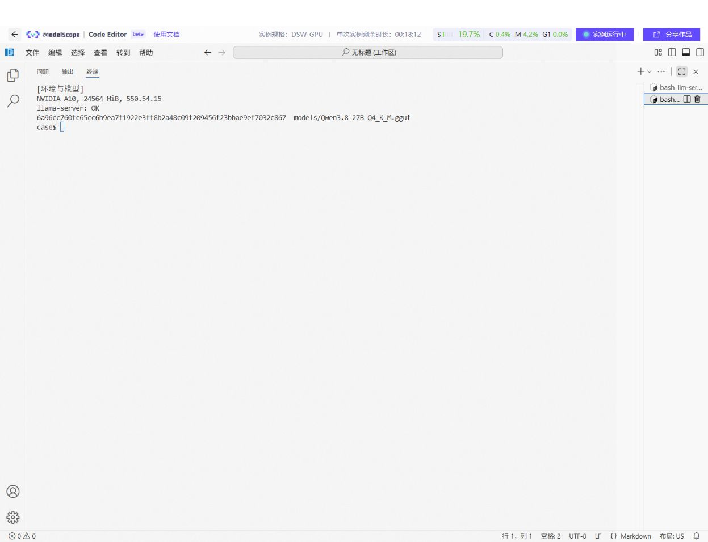
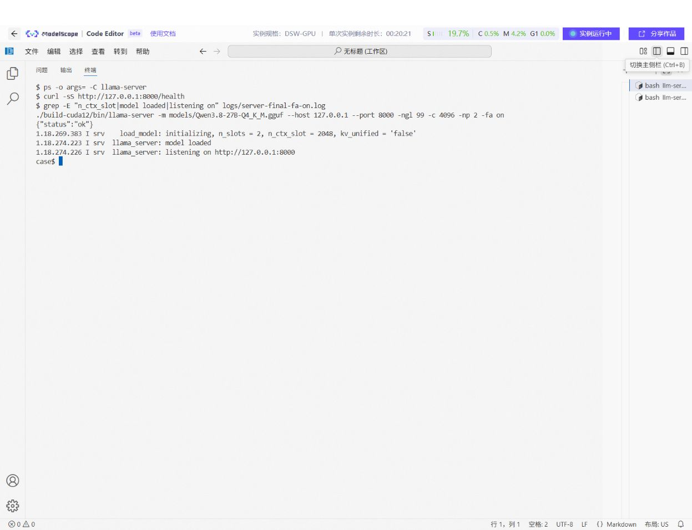
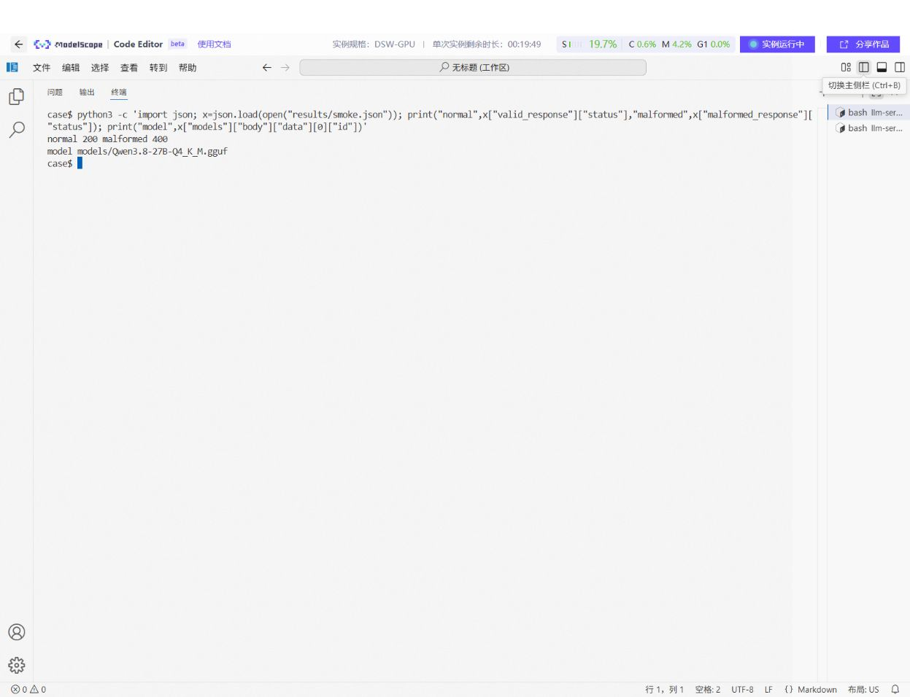
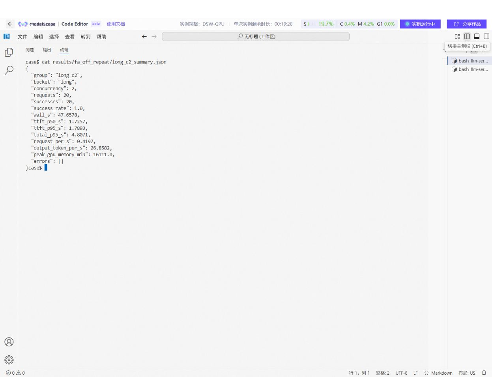
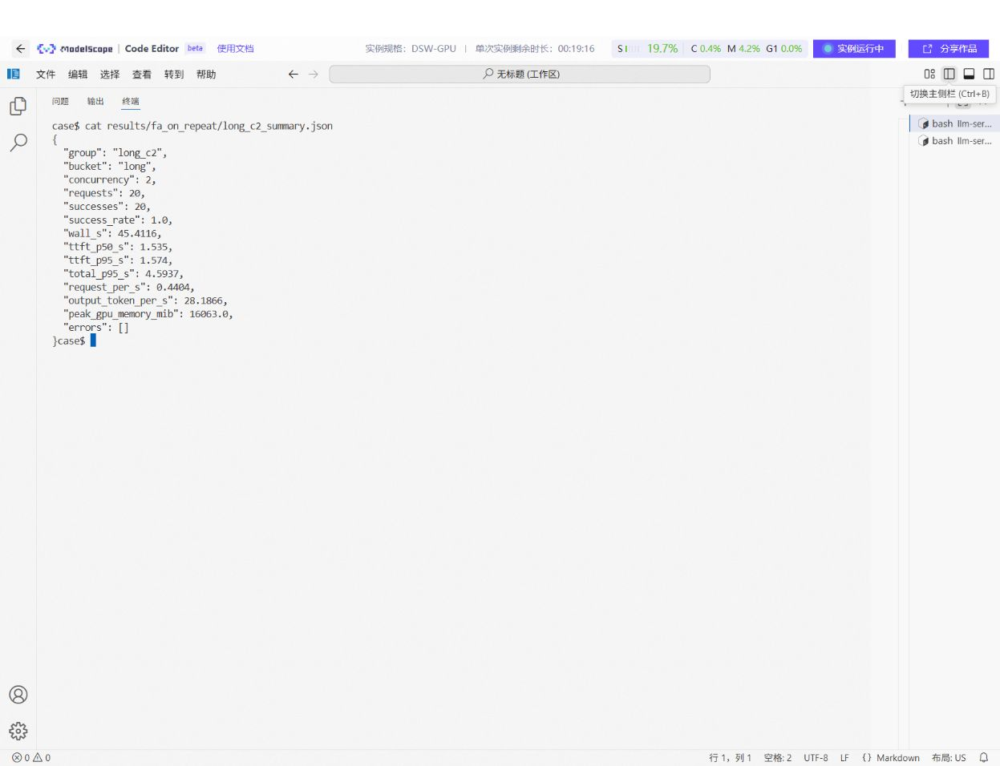

# Technical appendix: Qwen3.8-27B Q4 performance comparison on one 24GB GPU

[简体中文](CASE_TECHNICAL.md) | **English**

> Measured on 2026-10-17 in a ModelScope Notebook with an NVIDIA A10. These are cloud GPU measurements, not measurements on a phone, personal computer, or other edge device. The transferable result is a measurement method for constrained single-GPU deployment, not a predicted speed on other hardware.

## 1. Case information

**Overview:** deploy a fixed Qwen3.8-27B Q4_K_M GGUF on one A10 24GB. Using the same public Chinese deployment questions and llama.cpp's OpenAI-compatible API, compare Flash Attention off/on for first-output latency, throughput, success rate, and VRAM. Select a configuration against predefined thresholds.

- Audience: engineers deploying and accepting a local inference service on a single-GPU machine.
- Difficulty: intermediate. First reproduction takes approximately 1–3 hours, depending on the 16.8GB download, NFS reads, and CUDA build.
- Execution: ModelScope GPU Notebook Linux terminal; llama.cpp `b10430`; service bound only to `127.0.0.1:8000`.
- Scope: HTTP functionality, relative performance under a fixed workload, and malformed request handling. Answer accuracy and other GPUs were not evaluated.

## 2. Scenario and problem

Loading a model does not establish acceptable waiting times for concurrent users. The 24GB VRAM must hold approximately 16.8GB of Q4 weights, KV cache, and compute buffers. Without changing weights, the engineer needs to establish whether both concurrent requests succeed, when the first text appears, and how aggregate throughput and VRAM change.

The only changed option is `-fa off/on`. Input is `data/workload.jsonl`: 8 author-written public Chinese technical questions, comprising 4 short and 4 longer questions. They describe public deployment scenarios and contain no customer logs or personal data. The longer questions **do not actually fill 1600 input tokens**; “approximately 1600 tokens” describes a scenario within the question.

Request records show approximately `199–229` input tokens for the longer repeat group. With `max_tokens=64`, inspected responses ended with `length`. These are measurements of capped generation, not complete technical recommendations.

```text
Public JSONL questions -> fixed streaming HTTP requests -> llama-server/A10
       |                         |                              |
       |                         +-> TTFT/duration/usage/errors
       +-> short/long groups                                    +-> GPU samples
                                 |
                                 v
                   group summaries -> thresholds -> recommendation/report
```

## 3. Prerequisites

Recorded environment: ModelScope DSW-GPU Notebook, Linux x86_64, NVIDIA A10 24GB, driver `550.54.15`. Preinstalled CUDA 13.0 failed to initialize the GPU; the local CUDA 12.4 setup ran successfully. `nvidia-smi` compatibility does not identify the installed toolchain. The project-local toolchain used NVCC `12.4.131`, CUDART `12.4.127`, cuBLAS `12.4.5.8`, and CCCL `12.4.127`.

Client scripts use Python's standard library and `nvidia-smi`. Building requires Python 3, pip, CMake, a C++ compiler, make, aria2, and at least 35GB for the model, source, toolchain, and build.

Model: [Abiray/Qwen3.8-27B-Q4_K_M-GGUF](https://www.modelscope.cn/models/Abiray/Qwen3.8-27B-Q4_K_M-GGUF), file `Qwen3.8-27B-Q4_K_M.gguf`, size `16,810,714,400` bytes, SHA256 `6a96cc760fc65cc6b9ea7f1922e3ff8b2a48c09f209456f23bbae9ef7032c867`. Its download URL returned HTTP 200 to HEAD, with `X-Linked-Etag` matching SHA256. Recheck the model repository license before redistribution. Engine source is the official `b10430` tag, source-archive SHA256 `c93fdbe93170b1cf93027e1a945c66a70bcdfbd272eeedbe8c90afe0a5d55e1`, under its repository license.

In a fresh Notebook terminal, execute in order:

```bash
apt-get update
apt-get install -y aria2 cmake g++ make python3-pip git
cd /mnt/workspace
git clone https://github.com/qiyuefffs/llm-serving-diagnosis.git
cd /mnt/workspace/llm-serving-diagnosis/cases/llama-cpp-flash-attention
bash scripts/setup.sh
```

`setup.sh` uses 8 aria2 connections to download the model, official source, and NVIDIA CUDA 12.4 components; verifies model and source hashes; and builds `build-cuda12/bin/llama-server`. Reopen the terminal if newly installed tools are unavailable in the current shell. The Python scripts do not require a Kernel restart.

The actual build encountered missing CUDART/CCCL headers and a cuBLAS linker error. The script explicitly configures those headers, libraries, and `rpath-link`. Package-install permissions may differ between Notebook images. This script consolidates the successful operations; it has not been rerun completely in a second fresh instance. Perform that reproduction before formal submission.

### 3.1 Files and directories

Under `/mnt/workspace/`, run `git clone https://github.com/qiyuefffs/llm-serving-diagnosis.git`. Enter `cases/llama-cpp-flash-attention` and check `ls scripts data` for four scripts and `workload.jsonl`. `setup.sh` defaults to its Case directory; `PROJECT` can override it. After a full run, the main directories are:

```text
cases/llama-cpp-flash-attention/
  CASE.en.md
  scripts/{setup.sh,smoke.py,bench.py,report.py}
  data/workload.jsonl
  models/Qwen3.8-27B-Q4_K_M.gguf       # Downloaded by setup.sh
  cache/                             # Source and CUDA download caches
  cuda12/                            # Local CUDA 12.4 toolchain
  llama.cpp-b10430/                  # Pinned engine source
  build-cuda12/bin/llama-server      # Build output
  logs/{build-cuda12.log,server-fa-off.log,server-fa-on.log}
  results/{smoke.json,summary.csv,recommendation.json,report.md}
  results/{fa_off,fa_on,fa_on_repeat,fa_off_repeat}/
```

Source, CUDA components, caches, and weights consume substantial space and need not be committed.

Each workload line is a JSON object with `id`, `bucket`, and `prompt`. There are four questions in each of `short` and `long`. `bench.py` cycles through them in order for the 8- or 20-request groups. Verify input counts, labels, and hash:

```bash
wc -l data/workload.jsonl
python3 -c 'import json,collections; x=[json.loads(s) for s in open("data/workload.jsonl",encoding="utf-8")]; print(collections.Counter(r["bucket"] for r in x)); print([r["id"] for r in x])'
sha256sum data/workload.jsonl
```

Expected: 8 rows, `short: 4`, `long: 4`, SHA256 `18de6bb66f8cfe3e5dcad5df776cc200728c564aa781516dd5670007d73571f3`. These author-written samples represent deployment acceptance tasks; they are not production requests or customer logs.

### 3.2 Fixed parameters

| Item | Fixed value | Purpose and limits |
| --- | --- | --- |
| Model | `Qwen3.8-27B-Q4_K_M.gguf`, hash above | Same weights in both configurations |
| Engine | llama.cpp `b10430`, CUDA build | Exclude engine-version changes |
| Service | `127.0.0.1:8000`, `-ngl 99` | GPU layer offloading; local access only |
| Context/slots | `-c 4096 -np 2` | Log shows `2048` tokens per slot |
| Changed variable | `-fa off` / `-fa on` | Flash Attention comparison |
| Requests | `temperature=0`, `seed=42`, `max_tokens=64`, streaming | Same sampling; outputs may truncate |
| Groups | short/long, concurrency 1/2, 8 requests each; repeat at concurrency 2 with 20 per category | Not a VRAM-saturating long-context test |
| GPU sampling | `nvidia-smi` once per second | Sampled peak, not instantaneous peak |

The defaults in `bench.py` differ from this Case. Specify the parameters below explicitly. All clients use loopback within the same Notebook; requests do not traverse the public internet.

## 4. Procedure

Execute under `/mnt/workspace/llm-serving-diagnosis/cases/llama-cpp-flash-attention`. The original experiment used the repository root; historical screenshots retain old paths. This reorganization did not rerun GPU measurements.

Set the runtime library path:

```bash
cd /mnt/workspace/llm-serving-diagnosis/cases/llama-cpp-flash-attention
export LD_LIBRARY_PATH="$PWD/cuda12/cuda_nvcc-linux-x86_64-12.4.131-archive/lib${LD_LIBRARY_PATH:+:$LD_LIBRARY_PATH}"
./build-cuda12/bin/llama-server --help >/dev/null
sha256sum models/Qwen3.8-27B-Q4_K_M.gguf
nvidia-smi
```

Checks: `--help` exits successfully, the model hash matches, and `nvidia-smi` identifies the A10. Do not put the preinstalled CUDA 13 libraries ahead of this local directory.

**Visible outputs for Step 0:** `sha256sum` matches the 64-character hexadecimal digest; `nvidia-smi` lists the A10 and driver; `llama-server --help` exits `0`, followed later by actual model loading. The cloud `logs/build-cuda12.log` contains an early compilation failure and **is not successful build evidence**. A separate complete success log was not retained after correction. Figure 1 is a read-only check repeated in the same instance after the experiment. Before submission, run `setup.sh` fully in a fresh instance and retain its successful log or screenshots.

### Step 1: load the baseline

**Goal:** verify the fixed weights fit on the A10 and the local API becomes ready. First run `mkdir -p logs results` and check port 8000. If `/health` responds from an old service, stop that process using Step 4's procedure.

```bash
./build-cuda12/bin/llama-server \
  -m models/Qwen3.8-27B-Q4_K_M.gguf \
  --host 127.0.0.1 --port 8000 -ngl 99 -c 4096 -np 2 -fa off \
  > logs/server-fa-off.log 2>&1 &
SERVER_PID=$!
echo "$SERVER_PID" > logs/server.pid
until curl -fsS http://127.0.0.1:8000/health; do sleep 5; done
ps -p "$SERVER_PID" -o pid,args
tail -n 12 logs/server-fa-off.log
```

Initial `503 Loading model` is expected; wait for `{"status":"ok"}`. Reading approximately 16.8GB from the NFS workspace took approximately 3 minutes, excluded from request latency. Recorded VRAM usage at idle was approximately 16.1GB. `-c 4096` is the total context and `-np 2` creates two slots; the log shows `n_ctx_slot = 2048`. Input plus output must fit the slot.

If the loop persists, inspect `ps -p "$(cat logs/server.pid)"` and `tail -n 60 logs/server-fa-off.log` from another terminal. Stop waiting and troubleshoot if the process exited. Check the actual `-fa off` command and the `model loaded` / listening messages. Figure 2 verifies parameters and health; a standalone `ok` screenshot is insufficient startup evidence.

### Step 2: functionality and boundary checks

**Goal:** verify valid requests and malformed input handling through the OpenAI-compatible API. Exclude this check from benchmark statistics.

```bash
python scripts/smoke.py --output results/smoke.json
```

The output saves the model list and complete status/response for valid and malformed requests. The Chinese question returned `200` in `4.1286s`. Supplying `messages` as a string returned `400` rather than crashing the service. The answer is not verified as factual knowledge. If the valid request is not 200, inspect health and logs; if malformed input returns 200, error handling fails acceptance.

Inspect saved evidence:

```bash
python3 -c 'import json; x=json.load(open("results/smoke.json")); print("normal",x["valid_response"]["status"],"malformed",x["malformed_response"]["status"]); print("model",x["models"]["body"]["data"][0]["id"])'
```

Figure 3 should show the command and both statuses. `smoke.json` retains response bodies; the screenshot is only an index.

### Step 3: baseline measurements

**Goal:** after loading, record request latency, completed tokens, and GPU samples for `off`. A smoke request can warm the service before measurement; do not include it among the 8/20 requests. The actual experiment ran the functional check first.

```bash
python scripts/bench.py --workload data/workload.jsonl --output results \
  --config-id fa_off --concurrency 1 2 --requests 8 --max-tokens 64
python scripts/bench.py --workload data/workload.jsonl --output results \
  --config-id fa_off_repeat --concurrency 2 --requests 20 --max-tokens 64
```

Each `bucket × concurrency` combination runs 8 requests; the repeat uses 20 per category at concurrency 2. Requests use `temperature=0`, `seed=42`, streaming, and the same request-number prefix sequence across configurations. Varying request IDs is intended to prevent identical-prefix reuse from dominating the comparison.

Outputs include request JSONL, once-per-second GPU JSON, group summaries, and configuration metadata. Request fields are `request_id`, `prompt_id`, `status`, `success`, `ttft_s`, `total_s`, `prompt_tokens`, `completion_tokens`, `finish_reason`, `output_text`, and `error`.

The target repeat group's files include `results/fa_off_repeat/long_c2.jsonl`, `long_c2_gpu.json`, and `long_c2_summary.json`. `metadata.json` records model, workload path, concurrency, and output cap. Verify `requests=20`, `successes=20`, and exactly 20 JSONL rows. Figure 4 shows the baseline summary; inspect JSONL to verify complete request text and errors.

### Step 4: enable only Flash Attention

Stop the old process and replace `-fa off` with `-fa on`. Keep weights, other service parameters, inputs, and client settings fixed. Wait for health before benchmarking:

```bash
kill "$(cat logs/server.pid)"
while kill -0 "$(cat logs/server.pid)" 2>/dev/null; do sleep 1; done
./build-cuda12/bin/llama-server \
  -m models/Qwen3.8-27B-Q4_K_M.gguf \
  --host 127.0.0.1 --port 8000 -ngl 99 -c 4096 -np 2 -fa on \
  > logs/server-fa-on.log 2>&1 &
SERVER_PID=$!
echo "$SERVER_PID" > logs/server.pid
until curl -fsS http://127.0.0.1:8000/health; do sleep 5; done
ps -p "$SERVER_PID" -o pid,args
```

```bash
python scripts/bench.py --workload data/workload.jsonl --output results \
  --config-id fa_on --concurrency 1 2 --requests 8 --max-tokens 64
python scripts/bench.py --workload data/workload.jsonl --output results \
  --config-id fa_on_repeat --concurrency 2 --requests 20 --max-tokens 64
```

The actual order was **off 8 → on 8 → on 20 → off 20**. Reversing the order in the repeat helps identify one-off timing effects, but does not eliminate all system noise.

To reproduce that order, after `on` with 20 requests, stop it using this step's shutdown commands, restart with Step 1's `-fa off` settings, and execute `fa_off_repeat`. Step 3 groups commands by configuration for readability; **this paragraph defines the actual sampling order**. Never launch a replacement while the old service still listens on 8000. Verify `-fa on/off` with `ps` and logs. Figure 5 shows launch parameters; Figure 6 shows the on-repeat summary. Exclude initial loading from request statistics.

### Step 5: report and acceptance

**Goal:** build the comparison and recommendation for 12 measured groups exclusively from saved `_summary.json` files.

```bash
python scripts/report.py results --bucket long --concurrency 2 \
  --max-ttft-p95-s 2 --max-total-p95-s 5 --min-success-rate 1
```

Predefined targets for longer questions at concurrency 2: 100% success, TTFT P95 ≤2 seconds, and total-duration P95 ≤5 seconds. Outputs are `results/summary.csv`, `results/recommendation.json`, and `results/report.md`. The script selects only measured configurations. All four target configurations passed; the smallest TTFT P95 selected the initial 8-request `fa_on` group.

```bash
cat results/recommendation.json
sed -n '1,24p' results/report.md
wc -l results/summary.csv
```

Expect 12 groups and 13 CSV rows including the header. `recommendation.json` provides `source_file`, leading to the source summary and matching request JSONL. If nothing passes, retain `none passed` rather than selecting one favorable metric. Figure 7 shows the report.

### Screenshots and captions

All images are from this ModelScope instance and are stored in public `figures/`. Figures 0–7 check saved inputs, logs, and results **after the experiment**, rather than showing downloading, building, or all benchmarks rerun at capture time. The `case$` prompt hides the temporary hostname; scripts and results were not modified. Screenshots show readable summaries. Raw evidence remains in `results/` and `logs/`; request-level results are not yet public.


*Figure 0. Verify 8 rows, 4 questions per category, and the hash against `data/workload.jsonl`.*



*Figure 1. A10 24564 MiB, driver 550.54.15, successful `llama-server --help`, and weight hash. The terminal is shown after completion; commands are in Step 0.*



*Figure 2. `ps` shows `-fa on -c 4096 -np 2`; health is `ok`; logs show two slots, 2048 tokens per slot, and loopback listening. Figure 5 contains the historical baseline command.*



*Figure 3. Functional and error checks read from `results/smoke.json`, which contains the original requests and responses.*



*Figure 4. 20/20 successes, TTFT P95 `1.7893s`, output throughput `26.8582 token/s`. Request records: `results/fa_off_repeat/long_c2.jsonl`.*


*Figure 5. Shell history supports checking configurations and repeat order, but does not replace group metadata, server logs, or result files.*



*Figure 6. 20/20 successes, TTFT P95 `1.5740s`, output throughput `28.1866 token/s`, compared with the same group definition in Figure 4.*


*Figure 7. 12 groups; 4 target configurations pass. The recommendation selects initial `fa_on` and points to its summary. The CSV has 13 rows including the header.*

## 5. Complete run results

The target workload below comes from cloud group summaries. All 12 groups are transcribed in `results/observed-summary.csv`. Cloud request files are `results/<configuration>/long_c2.jsonl`; GPU samples are `long_c2_gpu.json`. The CSV is an offline transcription of terminal results, not original request records.

| Round | Configuration | Longer questions, concurrency 2 | TTFT P95 | Total-duration P95 | Output token/s | Sampled peak VRAM |
| --- | --- | ---: | ---: | ---: | ---: | ---: |
| Initial | off | 8/8 succeeded | 1.7796s | 4.845s | 27.1245 | 16111 MiB |
| Initial | on | 8/8 succeeded | 1.5469s | 4.6099s | 28.4047 | 16063 MiB |
| Repeat | off | 20/20 succeeded | 1.7893s | 4.8071s | 26.8582 | 16111 MiB |
| Repeat | on | 20/20 succeeded | 1.5740s | 4.5937s | 28.1866 | 16063 MiB |

In the repeat, TTFT P95 fell `0.2153s` (approximately `12.0%`), throughput rose approximately `4.9%`, and sampled peak VRAM was `48 MiB` lower. These are observations for this A10 and short-output workload, not guaranteed speedups. Short-question repeat TTFT P95 also fell from `1.4179s` to `1.2611s`. Both rounds agree in direction, but samples remain small; statistical significance and benefits for longer contexts are not established.

## 6. Metrics and acceptance

- **TTFT:** time from the client sending HTTP to the first nonempty streaming `content` or `reasoning_content`, including local HTTP and server queueing. It is not necessarily the start of the final answer.
- **Total duration:** client send to stream completion. P95 uses nearest rank; with 8 samples, it selects the 8th ordered observation, the maximum, making it sensitive to one slow request.
- **Output token/s:** sum of successful requests' server `usage.completion_tokens` divided by group wall time. If usage is absent, the script tries `/tokenize`; otherwise the count remains missing.
- **Peak VRAM:** once-per-second `nvidia-smi` samples may miss subsecond peaks.
- **Functionality:** healthy endpoint, valid HTTP 200 with nonempty stream, successes equal requests, malformed input returns 4xx, and JSON/CSV/Markdown artifacts exist.
- **Quality:** the target is latency and throughput, not content accuracy. The 64-token cap can truncate advice. Evaluate application content separately with manual or automated tests.
- **Access boundary:** bind only to `127.0.0.1`. Startup reports default CORS `*` and no API key. Do not expose this command's service directly; remote access requires authentication and network isolation.

## 7. Limitations and troubleshooting

1. **Driver/CUDA mismatch:** the installed driver supports up to CUDA 12.4; the preinstalled CUDA 13 path was unsuitable. Check `nvidia-smi` and `nvcc --version`; use `setup.sh`'s local toolchain and runtime path.
2. **Persistent 503:** inspect `logs/server-*.log` and `ps`. The model was on NFS and slow to load initially. Verify size/hash and wait for `model loaded`.
3. **Insufficient VRAM:** lower `-c`, `-np`, or GPU layers and remeasure. That configuration cannot inherit these results. Other 24GB GPUs are not guaranteed the same behavior.
4. **Workload scope:** public author-written scenarios, at most 2 concurrent requests and 64 output tokens. This does not represent long contexts, long generation, or multi-user production traffic. GPU clocks, temperature, neighboring workloads, and NFS caches remain factors.
5. **Reproduction variation:** identical hashes, code, and hardware can still yield different latency. Compare success rates and trends, then request JSONL and GPU samples.

## 8. Code, data, and evidence

- Scripts: `scripts/setup.sh`, `scripts/bench.py`, `scripts/smoke.py`, `scripts/report.py`. Public input: `data/workload.jsonl`, SHA256 `18de6bb66f8cfe3e5dcad5df776cc200728c564aa781516dd5670007d73571f3`.
- Cloud workspace: `/mnt/workspace/llm-serving-diagnosis`; raw evidence: `results/`, `logs/`, `environment/model.sha256`; archive: `case-evidence.tar.gz`. Public `figures/` contains 8 terminal verification screenshots. Temporary instance paths are not permanent public links.
- Sources: [ModelScope model](https://www.modelscope.cn/models/Abiray/Qwen3.8-27B-Q4_K_M-GGUF), [llama.cpp b10430](https://github.com/ggml-org/llama.cpp/tree/b10430), [NVIDIA CUDA redistribution](https://developer.download.nvidia.com/compute/cuda/redist/), and PyPI `nvidia-*` packages.

**Submission status:** measurements, scripts, explanatory workflow, and verification screenshots are in the public repository. The complete successful build log or contemporaneous screenshot is missing, and `setup.sh` has not been rerun in a second fresh instance. The web IDE download did not produce a retrievable artifact. Consequently, only summary transcriptions and screenshots are public; complete request JSONL, GPU samples, and logs remain in the cloud workspace. Before submission, verify the build in a fresh instance and publish sanitized raw evidence in the repository or durable storage. Do not present a temporary absolute path as a public evidence link.
