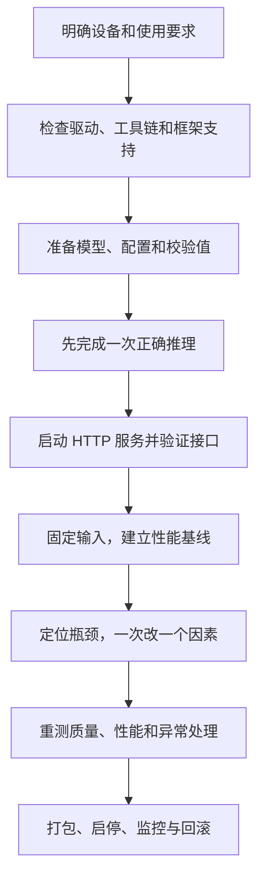

# 01 先确定部署目标，再安排操作顺序

[总目录](README.md) · [下一章：检查设备与环境](02-hardware-compatibility.md)

**本章目标：** 写清设备、模型、输入、输出和通过条件。后面每次选择框架、调整参数，都用这张任务单判断是否有用。

## 1. 从实际记录看，一次部署要做哪些事

FlowUs 中的实际材料包含 AMD 集显适配、Ubuntu 双卡 vLLM、DGX Spark 编译部署和模型环境打包。工具不同，操作顺序可以统一：



先理解这条线，再学每步用到的知识。比如，配置上下文时学 KV Cache；单卡放不下、需要双卡时学张量并行。每个概念都应对应一个实际问题。

## 2. 第一份材料：部署任务单

下面是填写方法。A10 数据来自仓库已有实验；正式业务的门槛需要根据实际应用另定。

| 项目 | 必须写清什么 | 已有 A10 实例 |
| --- | --- | --- |
| 部署位置 | 本地电脑、边缘工作站、Notebook 或服务器 | 魔搭 GPU Notebook |
| 设备 | 型号、可用内存、CPU 架构 | A10 24GB，Linux x86_64 |
| 模型 | 来源、具体文件、精度、校验值 | `Qwen3.8-27B-Q4_K_M.gguf` |
| 任务 | 输入从哪里来，最终交付什么 | 公开中文问题 → 流式回答与性能报告 |
| 请求规模 | 实际输入 token、输出上限、并发 | long 档约 199～229 输入 token，输出上限 64，客户端并发 2 |
| 功能门槛 | 哪些接口与异常必须通过 | 正常请求 200，畸形 messages 请求 400 |
| 性能门槛 | 在什么负载下达到什么数值 | 目标组成功率 100%，TTFT P95 ≤ 2s，总耗时 P95 ≤ 5s |
| 证据 | 能拿什么文件核对 | 截图、汇总 CSV、脚本；公开逐请求原始结果尚缺 |

64 token 上限用于短时性能对照，可能截断答案。业务质量测试应允许足够输出，并检查答案是否完成任务。

未知项先写“待采集”，不要猜测。可以直接使用[适配记录模板](templates/adaptation-record.md)。

## 3. 安装、部署和优化，各自需要什么证据

| 阶段 | 最低检查 | 还需要继续验证什么 |
| --- | --- | --- |
| 安装完成 | 程序能启动，依赖能导入 | 模型和设备算子能否执行 |
| 部署可用 | 模型正确，正常/异常接口和目标功能通过 | 目标并发下的延迟、内存与稳定性 |
| 优化有效 | 相同输入和口径下结果改善，质量过线 | 收益是否稳定，能否适用于其他负载 |

`import torch` 成功只说明包能导入。还要分配设备张量、执行运算并同步，才能完成一次基本后端验证。第 02 章给出代码。

DGX Spark 记录中 200 个请求全部成功，但平均首字等待约 148 秒。那次压力下请求最终完成，仍需对照应用的等待时间要求判断是否可用。

## 4. 一条请求怎样经过模型

以 `/v1/chat/completions` 为例：

```text
用户消息
 → 聊天模板：排列角色、文本和特殊标记
 → Tokenizer：将文本转成 token
 → 排队：等待可用资源
 → Prefill：处理输入，建立后续生成需要的状态
 → Decode：逐步生成后续 token
 → 流式返回，或生成结束后一次返回
```

**Tokenizer** 决定文本怎样变成 token。中文字符数、文件字节数都不等于 token 数。**聊天模板**决定用户、助手和系统消息怎样交给模型。权重正确但模板错误，也可能出现角色混乱、重复输出或答非所问。

**Prefill** 负责处理已有输入。输入越长，一般需要更多工作。**Decode** 在已有状态上继续生成。输出越长，请求占用服务的时间通常越长。多路请求共用设备时，还受到排队和调度影响。

因此，首字慢要分清排队久还是输入处理慢；完整回答慢，还要看实际输出长度和生成阶段速度。先明确问题发生在哪个阶段，再选优化参数。

## 5. 按操作顺序保存文件

下面是新实验的目录示例：

```text
deployment-run/
├── README.md           设备、目标、操作顺序
├── environment/        硬件、驱动、依赖、源码版本
├── models/             本地权重，大文件不提交普通 Git
├── config/             启动参数、模型清单
├── inputs/             可公开的测试输入
├── logs/               构建和服务日志
├── results/            请求记录、资源采样、汇总
└── operations/         启动、停止、恢复说明
```

每次实验使用独立结果目录，例如 `results/fa_off_repeat/`。不要覆盖旧结果，否则容易把新参数和旧日志放在一起。

## 6. 后续章节怎样使用真实实例

| 实例 | 用来学什么 | 材料边界 |
| --- | --- | --- |
| AMD 780M/890M 与 ROCm 笔记 | 芯片识别、后端选择、编译目标 | 逐项区分操作记录和测试结果 |
| 双 RTX 4080、vLLM、32B GPTQ INT4 | 容器挂载、双卡、服务参数 | 旧测试同时变更多个条件，不能计算严格优化收益 |
| DGX Spark、Qwen3.6-35B-A3B-FP8 | ARM64、新架构编译、服务压测 | FP8 有结果；BF16 只有命令时不补写成绩 |
| A10、llama.cpp、27B Q4 | 固定输入、FA 开关对照、HTTP 验收 | 有公开截图和汇总，完整逐请求证据尚未公开 |

云端 A10 用来学习部署和测量方法。迁移到笔记本或集显设备后，需要重新测内存、速度、温度和长时间表现，不能直接套用云端数字。

## 7. 本章检查与下一步

进入下一章前，应能回答：部署到哪台设备？模型是哪份文件？输入多长？输出多长？同时服务几路？怎样才算通过？

补齐任务单后，进入[第 02 章](02-hardware-compatibility.md)，采集环境并判断部署路线是否成立。
