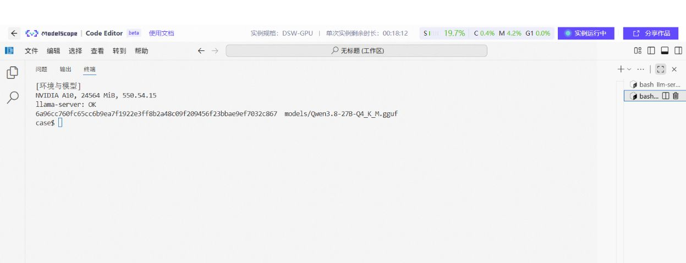

# 02 检查设备、驱动和运行环境

[总目录](README.md) · [上一章](01-engineering-and-request.md) · [下一章：准备模型](03-model-and-quantization.md)

**本章目标：** 在下载大模型和长时间编译前，确认设备、操作系统、工具链、框架和模型算子能够配合工作。

## 1. 按兼容链逐层检查

```text
设备与系统 → 驱动识别设备 → 工具链生成目标代码
 → 框架装有正确后端 → 模型结构和精度有可用算子 → 实际推理
```

底层通过后再查上一层。`nvidia-smi` 正常而 vLLM 启动失败，应继续查工具链、PyTorch、模型结构和算子。

双卡笔记曾记录“容器用不了 GPU”。这里要区分宿主驱动和 **NVIDIA Container Toolkit**：前者让系统访问 GPU；后者把设备和所需驱动能力接入容器。两者都要检查。

## 2. 保存 Linux 基本信息

以下命令在自己的实验目录执行，只读取设备和版本：

```bash
mkdir -p environment
uname -m > environment/cpu-architecture.txt
cat /etc/os-release > environment/os-release.txt
lscpu > environment/cpu.txt
free -h > environment/memory.txt
df -h . > environment/disk.txt
python3 --version > environment/python-version.txt 2>&1
```

| 检查项 | 怎样看 |
| --- | --- |
| CPU 架构 | `x86_64` 与 `aarch64` 的二进制不能直接混用；DGX Spark 走 ARM64 路线 |
| 内存 | 看当前可用量；系统安装容量并不都能分给模型 |
| 磁盘 | 权重、下载缓存、源码和编译产物都要占空间 |
| Python | 当前终端和 Notebook Kernel 可能使用不同解释器，要分别确认 |

不要将完整环境变量、shell 历史或全部进程参数直接公开，它们可能包含凭据或内部地址。

## 3. NVIDIA：分开核对三个版本

```bash
nvidia-smi > environment/nvidia-smi.txt
nvcc --version > environment/nvcc.txt 2>&1
```

使用 PyTorch 时，再在当前虚拟环境运行：

```python
import torch
print("torch:", torch.__version__)
print("wheel CUDA:", torch.version.cuda)
print("available:", torch.cuda.is_available())
if torch.cuda.is_available():
    print("device:", torch.cuda.get_device_name(0))
    print("capability:", torch.cuda.get_device_capability(0))
```

| 位置 | 说明什么 |
| --- | --- |
| `nvidia-smi` 的 CUDA 字段 | 驱动所支持的 CUDA 兼容能力 |
| `nvcc --version` | 当前找到的 CUDA 编译工具链 |
| `torch.version.cuda` | PyTorch wheel 的构建信息 |

这三项可能不同，并非看到一个相同数字才算正确。要按官方兼容说明核对组合，并实际运行验证。

**已有实例：** A10 Case 使用驱动 `550.54.15`。预装 CUDA 13.0 路线遇到兼容问题，后来使用项目目录内的 CUDA 12.4 工具链跑通。这只说明该实例的处理过程，不能推出所有机器都应安装 CUDA 12.4。



图注：已有 A10 实验结束后的环境与模型核验，供检查设备和模型身份；本轮没有重新执行 GPU 测试，该图也不替代成功构建日志。 图片仅去除下方空白，命令与输出保持原样；[查看完整原图](../../cases/llama-cpp-flash-attention/figures/01-environment-model-hash.png)。

## 4. AMD：先识别型号与 gfx，再选后端

Linux 上根据已安装的工具执行：

```bash
lspci | grep -Ei 'vga|display|amd'
rocminfo > environment/rocminfo.txt
hipconfig --full > environment/hipconfig.txt 2>&1
```

工具不存在时，先确认是未安装、PATH 未生效，还是当前根本未选择 ROCm 路线。

需要保存准确 GPU 型号和 `gfx` 标识。FlowUs 的 780M 配置涉及 `gfx1103`，其他集显不能照抄。`PYTORCH_ROCM_ARCH` 等变量只选择编译目标，不会自动补齐设备支持、驱动和算子。

ROCm 版 PyTorch 可这样核对：

```python
import torch
print("torch:", torch.__version__)
print("HIP:", torch.version.hip)
print("available:", torch.cuda.is_available())
if torch.cuda.is_available():
    print(torch.cuda.get_device_name(0))
```

ROCm 仍沿用不少 `torch.cuda` API 名称。结合 `torch.version.hip` 和设备名称判断实际后端。

Windows 集显还可能使用 Vulkan、DirectML、SYCL、OpenVINO 或厂商运行时。各路线的模型制品和加速方式不同，需要按设备与框架版本核对。

## 5. 做一次最小设备运算

前提：已经在当前环境安装 NVIDIA CUDA 或 ROCm 版 PyTorch。其他厂商插件使用各自测试方法。

```python
import torch
assert torch.cuda.is_available(), "当前环境未识别计算设备"
x = torch.ones((512, 512), device="cuda", dtype=torch.float32)
y = x @ x
torch.cuda.synchronize()
print("device:", y.device)
print("shape:", tuple(y.shape))
print("corner:", y[0, 0].item())
assert y[0, 0].item() == 512.0
```

**通过条件：** 分配成功、乘法执行完成、同步不报错，角值为 `512.0`。这验证小算子；模型里的注意力、量化、MoE 和通信算子还要继续测。

llama.cpp 不依赖 PyTorch。使用它时，构建目标后端后实际加载模型、生成文本，并核对设备日志，不必为它额外安装 PyTorch。

## 6. 新架构实例：DGX Spark 编译

| 项目 | FlowUs 原记录 |
| --- | --- |
| 设备 | DGX Spark GB10，128GB 内存 |
| 系统 | Ubuntu 24.04 |
| CUDA 路径 | `/usr/local/cuda-13.0` |
| vLLM 源码 | `17d87168d` |
| vLLM 版本字符串 | `0.19.1rc1.dev337+g17d87168d.cu130` |
| 模型 | Qwen3.6-35B-A3B / FP8 版本 |

笔记中保留了这条报错：

```text
Instruction 'cvt with .e2m1x2' not supported on .target 'sm_121'
```

它指向特定指令与编译目标的冲突。应确认设备能力、出错 kernel、源码版本和编译器，再找该组合的修复方式。

原笔记曾设置 `TORCH_CUDA_ARCH_LIST="12.0"`。它属于特定构建尝试，不能写成所有 GB10 项目的通用修复。第 10 章会沿报错解释排查过程。

## 7. 写一行完整兼容记录

| 设备/系统 | 后端 | 框架 | 模型 | 当前证据 |
| --- | --- | --- | --- | --- |
| A10 / Linux x86_64 | CUDA 12.4 | llama.cpp b10430 | 固定 GGUF / Q4_K_M | 公开服务截图、汇总 |
| GB10 / Ubuntu 24.04 | CUDA 13.0，依赖细项待补 | vLLM `17d87168d` | Qwen3.6-35B-A3B-FP8 | 200 请求文本结果，本轮未重跑 |
| 你的目标终端 | 现场采集 | 固定版本 | 固定制品 | 保存最小运行日志 |

不要只写“支持 AMD”或“支持 NPU”。至少说明设备、系统、版本、模型、精度和已验证功能。

**本章交付：** 环境文件、最小后端验证、兼容表。下一步[准备模型文件](03-model-and-quantization.md)。
