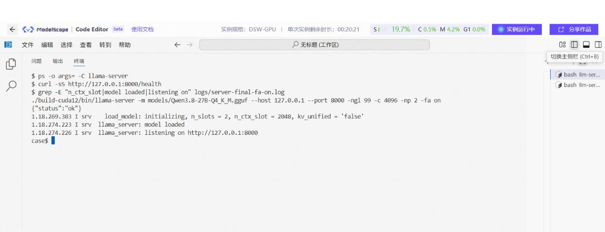

# 04 先算内存，再配置上下文与并发

[总目录](README.md) · [上一章](03-model-and-quantization.md) · [下一章：部署 llama.cpp](05-llama-cpp-practice.md)

**本章目标：** 解释内存花在哪里，估算能放多长输入、开几路请求，再用日志和采样验证。

## 1. 模型加载后为什么还会 OOM

权重常驻只是内存开销的一部分：

```text
峰值资源 ≈ 权重 + KV Cache + 计算缓冲
         + 图捕获/运行时开销 + 框架预留 + 其他进程
```

加载阶段没跑出最大长度和最大并发。请求进入后，KV、临时张量和运行时分配可能继续增长，所以“权重装进去了”不等于服务容量已验证。

独立 GPU 还要分别检查主机内存和显存。集显、Apple Silicon、DGX Spark 等共享或统一内存系统，应按平台机制理解；不能把系统内存与 GPU 可用量当成两份容量直接相加。

## 2. 权重体积怎样估

第一步可用参数量和位宽估一个下限：

```text
权重字节数下限 ≈ 参数量 × 每参数位数 ÷ 8
```

假设有 270 亿参数，全部恰好 4bit，算术下限是 13.5GB。实际制品还含量化比例因子、不同精度张量、元数据等，通常不会恰好等于这个数。

**已有实例：** Case 的 GGUF 文件是 `16,810,714,400` 字节，约 15.66GiB。记录中服务显存采样约 16GiB，还包括其他分配。不能简单用两个数字相减就宣称精确算出了 KV 大小；文件与设备内存的组织不完全相同。

## 3. KV Cache 是什么

生成后续内容时，常见注意力模型会复用历史 token 的 Key 和 Value。保存这些状态的区域称为 **KV Cache**，减少重复计算。

```text
输入 1000 token → 保存这段历史的 KV
继续输出 100 token → KV 通常继续增长
第二路独立请求 → 也需要保存自己的状态
```

它解释了为什么上下文和并发都会影响内存。具体占用取决于模型架构、KV 精度、分块、预分配和缓存共享方式。

## 4. 普通 MHA/GQA 的估算方法

对保存完整 K/V、维度规则的常见模型，可以先使用：

```text
KV 字节数 ≈ 2 × 层数 × KV 头数 × 每头维度
           × 总驻留 token 数 × 每元素字节数
```

前面的 `2` 对应 K 和 V。GQA 使用 KV 头数，不能直接拿 query 头数代入。多序列长度相同时，总驻留 token 数可先估为“序列数 × 每序列长度”。

**下面是教学算例，不是 Qwen3.8 的真实配置：** 假设 32 层、8 个 KV 头、每头 128 维、FP16 KV，两路各 4096 token。

```python
layers = 32
kv_heads = 8
head_dim = 128
bytes_per_element = 2
sequences = 2
tokens_per_sequence = 4096
kv_bytes = (2 * layers * kv_heads * head_dim * bytes_per_element
            * sequences * tokens_per_sequence)
print(kv_bytes, 'bytes')
print(kv_bytes / 1024**3, 'GiB')
```

算术结果是 `1073741824 bytes`，即 `1.0 GiB`。真实部署还要加块管理、对齐和缓冲等开销。

MLA、滑动窗口、混合注意力/状态空间、跨层共享等架构不能直接套这个公式，应看框架实际缓存实现和加载日志。KV 量化还带有缩放、元数据和可用 kernel 条件。

## 5. llama.cpp 实例：4096 上下文为什么每路只有 2048

A10 Case 的启动参数：

```bash
-c 4096 -np 2
```

该固定版本的日志显示：每槽 `n_ctx_slot = 2048`。因此不能对外写成“两路请求各有 4096 token”。请求模板、历史消息、用户输入和新生成内容，都要符合单槽实际限制。

新版本可能调整内存与槽位行为，要以当前 `--help`、启动日志和边界请求为准。



图注：已有实验中的 FA on 服务核验。检查命令、模型加载与就绪状态；每槽容量还应核对完整启动日志，不能只看健康接口返回 `ok`。 图片仅去除下方空白，命令与输出保持原样；[查看完整原图](../../cases/llama-cpp-flash-attention/figures/02-server-fa-on-health.png)。

## 6. vLLM 的三个参数分别控制什么

| 参数 | 主要作用 | 不应怎样理解 |
| --- | --- | --- |
| `--max-model-len` | 模型请求长度上界，具体含义按版本 | 当前每条请求实际都这么长 |
| `--max-num-seqs` | 调度可同时处理的序列上限 | 已经发出的客户端请求数 |
| `--gpu-memory-utilization` | 为引擎规划可用 GPU 内存的比例 | GPU 算力利用率目标 |

`--max-num-batched-tokens` 控制一次调度中的 token 预算，也会影响 Prefill 分块和生成调度，不等于模型上下文长度。

DGX Spark 笔记设置 `--max-num-seqs 4`，压测却同时提交 200 个请求。这两项并不矛盾：200 是客户端压力，服务只允许部分序列进入计算，其他请求等待，因此首字延迟很高。

## 7. 怎样用实际记录修正估算

建议分三个时刻采集，输入和参数固定：

| 时刻 | 记录什么 | 用途 |
| --- | --- | --- |
| 启动前 | 系统可用内存、已有 GPU 占用 | 解释背景资源 |
| 模型就绪但无请求 | 设备/主机内存、引擎分配日志 | 区分常驻与请求增量 |
| 最大目标负载 | 内存采样峰值、失败、抢占、延迟 | 验证实际容量 |

NVIDIA 可用：

```bash
mkdir -p logs
nvidia-smi --query-gpu=index,memory.used,memory.total,utilization.gpu,power.draw \
  --format=csv -l 1 > logs/gpu-samples.csv
```

另开终端执行，结束后用 Ctrl+C 停止。每秒采样可能漏掉瞬时峰值，因此标注“采样峰值”，不要写成精确峰值。共享内存设备需同时观察系统内存、交换和平台专用统计。

### 7.1 已有低显存实例：RTX 2060 混合推理

FlowUs 的 RTX 2060 12GB、i5-12400F、32GB 内存记录使用 `Qwen3-30B-A3B-Q6_K.gguf`，走 CPU/GPU 混合路线。单次记录中输入 9 token、生成 182 token，生成评估约 34.62 秒，即约 5.26 token/s；同时观察到较高主机内存和交换活动。

这说明资源检查不能只看 12GB 显存，还要看主机工作集、交换、实际卸载和传输。原始命令含旧参数且版本信息不全，本体系不将它作为当前可直接复制的启动配置，也不把单次引擎计时改写成 HTTP 吞吐。

## 8. OOM 时按什么顺序缩小范围

1. 停止当前压测，保留失败日志和最后一组参数。
2. 确认不是其他进程占用，也不是磁盘满导致的另一类失败。
3. 客户端降到并发 1，缩短输入与输出，验证基本链路。
4. 若基本链路通过，再分别增加上下文或并发，找到边界。
5. 根据日志选择降低上下文、减少活跃序列、减少图捕获开销或更换模型制品。
6. 若尝试 KV 量化或混合卸载，重新做质量和速度回归。

不要同时更换模型、上下文、并发和量化，否则很难知道到底是哪项解决了问题。

**本章交付：** 一份预算、三阶段资源记录、目标负载容量结论。下一步[真正部署一个服务](05-llama-cpp-practice.md)。
