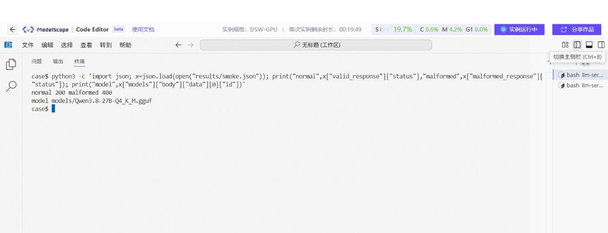
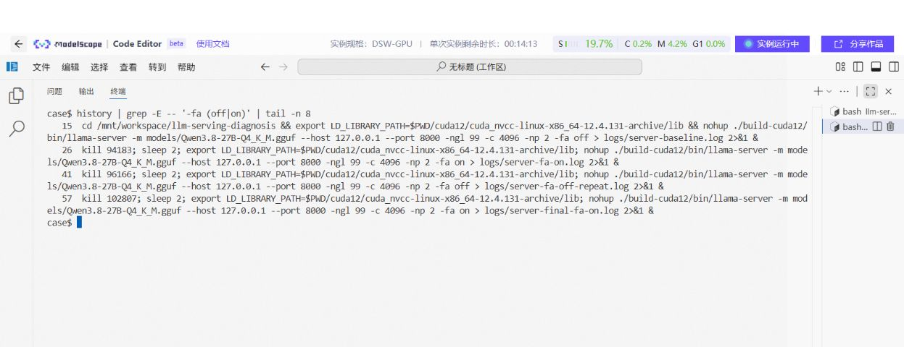

# 05 用 llama.cpp 跑通单机服务

[总目录](README.md) · [上一章](04-memory-and-kv-cache.md) · [下一章：迁移到端侧设备](06-edge-platforms.md)

**本章目标：** 完成固定版本构建、模型加载、接口验证和停服，得到后续测试共用的最小服务。

本章主线引用已有 A10 Case，保留它的模型和参数；完整原文在[独立 Case](../../cases/llama-cpp-flash-attention/CASE.md)。本轮做的是知识整理和离线核对，没有重新运行云端 GPU。脚本尚缺第二个全新实例从头复现记录，照做时应保留自己的完整日志。

## 1. 为什么这里先用 llama.cpp

当前实践已经采用 GGUF、Q4 和 llama-server。用同一条路线，可以先把环境、模型和测量口径固定，再迁移到其他设备。

llama.cpp 包含模型执行、量化及服务等工具。不同后端可面向 CPU、CUDA、Metal、HIP、Vulkan、SYCL 等，实际能力依源码版本和构建参数。选了某个后端，还要检查模型是否真正卸载到目标设备。

## 2. 准备环境与目录

已有实例：Linux x86_64、A10 24GB、驱动 `550.54.15`。磁盘至少预留约 35GB；源码、工具链、下载缓存可能继续增长。

以下安装命令用于有管理员权限的 Linux Notebook。其他环境按自己的包管理器准备相同工具。

```bash
apt-get update
apt-get install -y aria2 cmake g++ make python3-pip git
cd /mnt/workspace
git clone https://github.com/qiyuefffs/llm-serving-diagnosis.git
cd llm-serving-diagnosis/cases/llama-cpp-flash-attention
```

`/mnt/workspace/` 是 Notebook 工作区。这里的文件不会自动成为公众可下载链接。可公开的代码、样例和结果放在仓库；权重按来源地址下载并校验。

## 3. 固定版本并构建

```bash
bash scripts/setup.sh
```

脚本执行顺序：

1. 用 aria2 下载固定 GGUF，核对 SHA256。
2. 下载 llama.cpp `b10430` 源码包，核对源码哈希。
3. 在项目内准备 CUDA 12.4 的 NVCC、运行库、cuBLAS 和 CCCL。
4. 用 `GGML_CUDA=ON`、A10 架构 `86` 构建 `llama-server`。
5. 执行 `--help` 检查二进制能否启动。

此处局部工具链是已有 A10 环境的处理，不要求其他设备重复组装 CUDA。DGX Spark、AMD、Mac 使用各自受支持路线。

```text
cases/llama-cpp-flash-attention/
├── models/Qwen3.8-27B-Q4_K_M.gguf
├── llama.cpp-b10430/
├── cuda12/
├── build-cuda12/bin/llama-server
├── data/workload.jsonl
├── logs/
└── results/
```

**检查：** 构建命令退出码为 0，二进制存在，`--help` 能执行。历史记录缺少修正后完整成功构建日志，不能把早期失败日志当成成功证明。复跑时保存最终成功日志和退出码。

使用现成系统 CUDA 时，典型构建结构如下，仅作另一种环境下的模板：

```bash
cmake -S /path/to/llama.cpp -B /path/to/build \
  -DGGML_CUDA=ON -DCMAKE_BUILD_TYPE=Release
cmake --build /path/to/build --target llama-server -j 4
```

不能给 A10、GB10 和 AMD 共用一个构建目录。更换后端或工具链后应新建目录，避免旧 CMake 配置残留。

## 4. 在前台启动第一份基线

回到 Case 目录，先补好运行时库路径：

```bash
export LD_LIBRARY_PATH="$PWD/cuda12/cuda_nvcc-linux-x86_64-12.4.131-archive/lib${LD_LIBRARY_PATH:+:$LD_LIBRARY_PATH}"
mkdir -p logs results
set -o pipefail
./build-cuda12/bin/llama-server \
  -m models/Qwen3.8-27B-Q4_K_M.gguf \
  --host 127.0.0.1 --port 8000 \
  -ngl 99 -c 4096 -np 2 -fa off \
  2>&1 | tee logs/server-fa-off.log
```

第一次建议前台运行，能直接看加载失败原因。另开终端做后续检查；这一窗口保留给服务。

| 参数 | 在本次固定版本中的作用 |
| --- | --- |
| `-m` | 要加载的模型路径 |
| `--host 127.0.0.1` | 仅在当前机器监听 |
| `--port 8000` | 本地 API 端口 |
| `-ngl 99` | 请求尽量卸载模型层到 GPU，实际层数看日志 |
| `-c 4096` | 此次配置的总上下文 |
| `-np 2` | 两个槽位；日志中每槽 2048 token |
| `-fa off` | 基线关闭 Flash Attention |

## 5. 检查模型就绪与真实请求

在第二个终端切到同一 Case 目录：

```bash
curl -i http://127.0.0.1:8000/health
curl -fsS http://127.0.0.1:8000/v1/models
python3 scripts/smoke.py --output results/smoke.json
```

刚启动时出现加载状态不等于失败。若长时间未就绪，查看服务终端；不要用无限重试掩盖进程已经退出的问题。

已有实例正常请求返回 `200`，记录耗时 `4.1286s`；将 `messages` 故意写成字符串的异常请求返回 `400`。具体内容和状态保存在 `smoke.json`。



图注：已有 A10 实验的功能核验，正常与异常请求分别为 200/400。这项检查证明接口行为，不证明回答事实正确。 图片仅去除下方空白，命令与输出保持原样；[查看完整原图](../../cases/llama-cpp-flash-attention/figures/03-smoke-status.png)。

检查内容还应包括：返回的模型身份是否正确；输出非空；角色和模板没有错乱；长输入失败时是否有明确错误；服务失败后是否还能正常处理下一条请求。

## 6. 构建、加载、请求耗时分别记录

| 时间 | 从哪里开始到哪里结束 | 用途 |
| --- | --- | --- |
| 构建时间 | 编译开始到产物生成 | 评估安装和交付成本 |
| 冷启动 | 进程启动到模型就绪 | 评估首次使用等待 |
| 预热请求 | 就绪后的固定暖机请求 | 建立测试起点 |
| 正式请求 | 客户端发出到首输出/结束 | 计算用户等待与服务吞吐 |

已有 A10 记录中，从 NFS 读取约 16.8GB 权重，首次就绪约 3 分钟。这是该实例的冷加载观察，不能混进 TTFT，也不能预测本地 SSD 的启动耗时。

## 7. 怎样停止并切换配置

前台服务用 Ctrl+C 停止。等待进程退出，确认端口没有旧服务，再启动新配置。

若要测试 FA on，仅修改 `-fa off` 为 `-fa on`，日志改成 `logs/server-fa-on.log`，其余参数保持一致。启动后重新检查健康接口和日志中的实际配置。



图注：已有实验对启动历史的核验，用来确认只切换 FA 参数。正式对照还要核对实际运行进程和对应结果目录。 图片仅去除下方空白，命令与输出保持原样；[查看完整原图](../../cases/llama-cpp-flash-attention/figures/05-start-command-history.png)。

后台或常驻服务的启停、就绪、恢复放在[第 12 章](12-delivery-and-learning.md)。先完成前台最小链路，再引入进程管理。

## 8. 本章验收

| 检查点 | 通过条件 |
| --- | --- |
| 版本和模型 | 二进制版本、模型哈希有记录 |
| 后端 | 日志显示目标设备、实际卸载层数，无意外 CPU 回退 |
| 就绪 | `/health` 返回可用，日志没有后续致命错误 |
| 功能 | 正常请求、模型身份、模板检查通过 |
| 异常 | 不合法输入有明确错误，服务仍可继续使用 |
| 生命周期 | 可以停止，资源释放，再次启动正常 |

**本章交付：** 构建产物、服务日志、功能结果和启停步骤。需要迁移到笔记本或其他终端时，继续[第 06 章](06-edge-platforms.md)。
