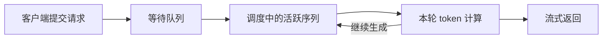

# 07 配置服务、上下文、批处理与缓存

[总目录](README.md) · [上一章](06-edge-platforms.md) · [下一章：建立性能基线](08-benchmark-and-quality.md)

**本章目标：** 弄清客户端压力与服务容量的区别，完成一份路径、端口、模型名称一致的服务配置，再理解常见调度参数。

## 1. 什么时候选择 llama-server，什么时候选择 vLLM

| 当前条件 | 优先验证的路线 | 主要检查 |
| --- | --- | --- |
| 已有 GGUF，单机、本地或异构后端 | llama-server | 架构、后端、卸载、槽位和模板 |
| 已有受支持 HF 模型，GPU 服务、多请求调度 | vLLM | 模型/量化 kernel、KV 容量、调度和通信 |
| Apple 设备与 MLX 制品 | MLX 服务或相应管理框架 | 实际 API 与功能支持 |
| 厂商专用 IR 或 NPU 图 | 对应运行时 | 导出、编译、形状和算子支持 |

框架名只是起点。最终都要通过相同功能样例、业务质量、延迟和资源验收。

## 2. 先把模型挂载正确：双卡 vLLM 实例

FlowUs 双卡笔记记录 Ubuntu 22.04、RTX 4080 16GB × 2、128GB 内存、32B GPTQ INT4。旧命令存在“挂载根目录与 `--model` 子目录不一致”的风险。

下面将路径统一为：宿主模型目录 → 容器 `/models/model` → `--model /models/model`。它是对历史命令结构的修正示例；原记录缺少完整模型 revision 和镜像 digest，不能视为已在全新环境验证的安装包。

前提：已安装兼容的驱动、Docker、NVIDIA Container Toolkit；模型完整位于 `/srv/models/deepseek-r1-32b-gptq-int4`；镜像版本与模型兼容；8000 端口空闲。

```bash
nvidia-smi
nvidia-ctk --version
docker version
MODEL_DIR='/srv/models/deepseek-r1-32b-gptq-int4'
VLLM_IMAGE='vllm/vllm-openai:v0.8.5'
test -f "$MODEL_DIR/config.json"
```

```bash
docker run --rm --name edge-vllm --gpus all --ipc=host \
  --mount type=bind,source="$MODEL_DIR",target=/models/model,readonly \
  -p 127.0.0.1:8000:8000 \
  "$VLLM_IMAGE" \
  --model /models/model --served-model-name edge-model \
  --host 0.0.0.0 --port 8000 \
  --tensor-parallel-size 2 \
  --max-model-len 8192 --max-num-seqs 8 \
  --gpu-memory-utilization 0.85
```

容器内监听所有接口，宿主只将端口发布到 `127.0.0.1`。模型目录只读挂载。使用前要核对这个历史镜像支持的 CLI，不直接拿旧参数套当前版本。

**检查：** 服务日志中的模型路径、精度、两张 GPU、KV 容量正确；`/v1/models` 包含别名 `edge-model`；实际请求使用同一个别名。

```bash
curl -fsS http://127.0.0.1:8000/v1/models
curl -fsS http://127.0.0.1:8000/v1/chat/completions \
  -H 'Content-Type: application/json' \
  -d '{"model":"edge-model","messages":[{"role":"user","content":"用一句话说明服务是否正常。"}],"temperature":0,"max_tokens":128,"stream":false}'
```

## 3. 并发至少有三个位置



| 概念 | 例子 | 影响 |
| --- | --- | --- |
| 客户端并发 | 同时等待 200 个请求 | 服务可能形成长队列 |
| 活跃序列上限 | vLLM `--max-num-seqs 4` | 限制同时参与调度的序列 |
| 单轮 token 预算 | `--max-num-batched-tokens 8192` | 影响输入分块和生成调度 |

DGX Spark 记录中 `--max-num-seqs 4`，压测 `--request-rate inf --num-prompts 200`。客户端突发压力很大，服务内部只能分批处理。平均 TTFT 约 148 秒，不能解释成每条输入本身都需要 148 秒计算。

## 4. Continuous batching 怎样工作

假设三条请求分别要生成 20、80、200 个 token。固定批次如果一直等最长请求，会浪费已经完成请求的资源。

连续批处理在迭代边界移除已完成序列，并允许新序列进入，让不同长度请求共同使用设备。收益通常体现在整体吞吐和资源利用，但请求也会相互竞争计算和内存。

增加活跃序列可能提高吞吐，同时降低单路生成速度、增加尾延迟。第 08 章的 oMLX 记录就出现了这种现象。

## 5. Chunked Prefill：让长输入分段进入

一个长输入可能占用较长计算时间，影响已经开始生成的请求。分块 Prefill 将输入拆成若干计算块，参与调度。

适合检查的场景：长输入与短交互混跑。实验时固定输入分布，比较短请求尾延迟、总吞吐、长请求 TTFT和资源，而不是只看一个均值。

`--max-num-batched-tokens` 太大，可能增加一次计算和缓冲；太小，又可能产生更多调度开销。它需要结合负载测量。

## 6. Prefix Cache：复用相同前缀，减少重复输入计算

例如两条请求都以相同系统说明和长文档开头，只在最后的问题不同。公共 token 前缀的状态可能复用。

```text
请求 A：[相同系统说明][相同文档][问题 A]
请求 B：[相同系统说明][相同文档][问题 B]
                         ↑ 这里只能复用符合实现条件的相同 token 前缀
```

它不是语义检索。文字看起来相近、模板不同、tokenizer 不同或前面多了一个随机编号，都可能改变可复用前缀。缓存是否命中还取决于块大小、淘汰、模型和后端支持。

**修订旧笔记：** FlowUs 曾写“vLLM 通过 RadixAttention 实现 Prefix Cache”。这里改为：vLLM 的 APC 使用基于哈希的 KV 块复用设计；RadixAttention 是 SGLang 相关机制。二者都有前缀复用目标，不能互相替换实现名称。参见[官方设计](https://docs.vllm.ai/en/stable/design/prefix_caching/)。

### 怎样测缓存收益

1. 固定系统说明、文档、模板和 tokenizer。
2. 第一组测冷缓存，保存实际输入长度。
3. 第二组重复相同前缀，记录命中统计与 TTFT。
4. 另测不共享前缀的负载，避免只对理想情况报告成绩。
5. 如要比较其他优化，应让两边缓存状态一致。

多轮对话也不自动等于全部命中。历史怎样重新组成 token、是否保留和淘汰缓存、混合架构是否支持，都要按实际日志确认。

## 7. 图捕获、KV 精度与采样参数

| 配置 | 解决什么问题 | 验证什么 |
| --- | --- | --- |
| CUDA Graph / eager | 降低部分重复调度开销，或简化执行路径 | 启动耗时、内存、实际负载速度 |
| KV dtype | 降低缓存占用或适配某种执行路径 | 设备支持、质量与容量 |
| temperature/top_p/top_k | 影响生成内容与长度分布 | 两边参数一致，质量与实际 token 数 |
| generation config / chat template | 决定默认采样与消息编码 | 显式参数及实际生效值 |

不要把 eager 当成固定的“慢速模式”，也不要把图捕获当成一定更快。要比较当前设备和 shape 的实际表现。

## 8. 写出一份可复查的配置说明

至少保存：引擎与模型身份、后端、端口与模型别名、上下文、活跃序列、token 预算、KV 精度、缓存、模板、采样、启动日志和客户端压力。

**本章验收：** 服务路径和模型名一致，API 可用，能解释三个并发位置，清楚本轮改变了哪些参数。随后进入[第 08 章](08-benchmark-and-quality.md)建立基线。
