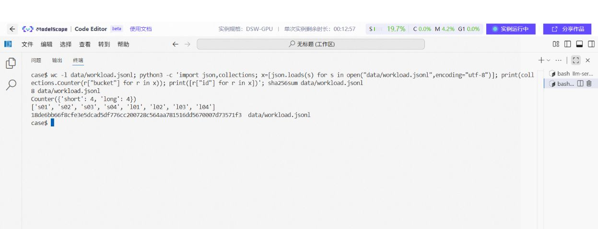
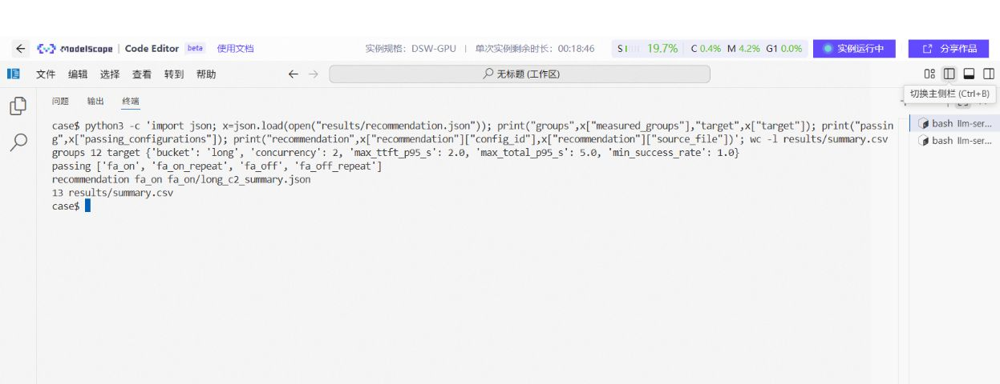

# 08 建立基线：测试输入、延迟、吞吐和质量

[总目录](README.md) · [上一章](07-serving-and-scheduling.md) · [下一章：做优化实验](09-profiling-and-optimization.md)

**本章目标：** 先测出一份可信基线，能回答“在什么输入、什么压力下，系统表现怎样”。优化必须与这份基线按同一口径比较。

## 1. 先决定测试哪一层

| 层次 | 常用工具 | 能回答什么 |
| --- | --- | --- |
| 引擎基本计算 | `llama-bench` | 固定 token 规模的输入处理和生成速度 |
| 本地推理管线 | OpenVINO `PerfMetrics` 等 | 管线定义边界内的耗时 |
| HTTP 服务 | `vllm bench serve`、EvalScope、Case 脚本 | 排队、流式输出、请求延迟与整体吞吐 |
| 最终应用 | 实际客户端加固定任务 | 用户何时看到答案、任务是否完成 |

引擎速度不能直接当成 HTTP 速度，管线指标也不能直接当成用户端延迟。报告中保留工具、版本和计时边界。

## 2. 每个指标怎样理解

| 指标 | 本文采用的解释 | 常见误读 |
| --- | --- | --- |
| TTFT | 客户端开始请求到首个有效输出片段 | 当成纯 Prefill 时间 |
| 完成耗时 | 请求开始到流式结束/响应完成 | 忽略输出长度不同 |
| TPOT | 每请求首输出之后的平均 token 时间，常近似为 `(结束-首输出)/(输出token数-1)` | 当成每两个片段的间隔 |
| ITL | 相邻 token 的间隔，或工具定义的流式间隔 | 一个 SSE 片段一定等于一个 token |
| 输出吞吐 | 同一测量窗口内完成的输出 token 总量 / 窗口秒数 | 把输入与输出混算成生成速度 |
| P95/P99 | 指定统计方法下的尾部延迟 | 小样本也能稳定代表线上尾延迟 |
| 成功率 | 符合预先规则的成功请求比例 | HTTP 200 就代表内容质量合格 |

思考模型要区分“首个推理片段”与“首个最终答案”。本仓库 Case 脚本的 TTFT 会接受非空 `content` 或 `reasoning_content`，因此不能直接解释成用户已看到最终答案。

## 3. 固定一张负载说明表

至少写清：模型与模板、输入来源和实际 token 数、输出上限、是否强制长度、温度、种子、请求数、客户端并发或到达速率、预热和缓存状态。

| 负载 | 输入 | 输出 | 压力方式 | 用途 |
| --- | --- | --- | --- | --- |
| 短问答 | 公开短问题 | 按任务完成需要设置 | 并发 1 | 检查交互体验 |
| 业务代表输入 | 脱敏或公开样例 | 保留真实长度分布 | 目标到达率 | 业务容量 |
| 边界输入 | 接近目标上下文上限 | 预留足够生成空间 | 从并发 1 开始 | 检查容量与错误处理 |
| 固定长度随机负载 | 固定 tokenizer 和种子 | 固定目标长度 | 并发扫描/突发 | 工程压力测试，不作答案质量测试 |

同一条提示重复多次，容易受到缓存影响。缓存研究可以专门这样设计；其他对照要保证缓存条件可比。

## 4. 练习一：先离线核对已有证据

这个练习不下载模型，不需要 GPU。在仓库根目录执行：

```bash
python docs/01-deployment-foundations/examples/verify_records.py
```

脚本检查公开输入的 8 行 JSONL 与哈希、A10 的 12 组汇总，以及几组笔记转录中的算术关系。本次本地实际运行的部分输出：

```text
Public workload: 8 prompts; SHA256 verified
A10 transcribed summary: 12 groups
A10 long/c2, 20 requests/group: TTFT P95 reduction = 12.03%
A10 long/c2, 20 requests/group: output throughput gain = 4.95%
DGX FP8: 25600/297.46 = 86.06 output token/s
Intel OpenVINO: INT4/INT8 throughput ratio = 2.09x
```

这项检查证明转录的计数和计算一致，不能补出缺失的原始请求日志，也不代表重新完成了这些硬件实验。完整输出见[离线核对记录](examples/verified-output.txt)。

## 5. 练习二：用已有 A10 服务测固定输入

前提：已按第 05 章启动 `-fa off` 服务并通过功能检查。以下命令在 Case 目录执行：

```bash
python3 scripts/bench.py \
  --workload data/workload.jsonl --output results \
  --config-id baseline_local --concurrency 1 2 \
  --requests 20 --max-tokens 64
```

`baseline_local` 是你自己的新测量目录，不能写成历史实验成绩。脚本将每种 bucket 与并发分别运行 20 次。

每组主要产物：

```text
results/baseline_local/
├── metadata.json
├── short_c1.jsonl
├── short_c1_gpu.json
├── short_c1_summary.json
└── ... 其他 bucket × concurrency 分组
```

| 文件 | 检查什么 |
| --- | --- |
| `metadata.json` | 客户端参数、模型别名、UTC 时间与初始 GPU 采样；引擎版本和启动参数需另存 |
| 请求 JSONL | 状态、实际 token 数、TTFT、完成原因、文本与错误 |
| GPU JSON | 每秒采样的内存、利用率和功率 |
| summary JSON | 请求数、成功数、分位数与窗口吞吐 |

该脚本用响应 usage 计数，缺失时尝试 `/tokenize`。需检查 `token_source`：回退计数有额外请求和边界差异。若 token 数无法取得，吞吐应留空，不能用字符数冒充。



图注：历史实验的 8 条公开输入检查。`long` 是样例分组名称，实际只有约 199～229 输入 token，不能称为 1600 token 长上下文测量。 图片仅去除下方空白，命令与输出保持原样；[查看完整原图](../../cases/llama-cpp-flash-attention/figures/00-workload-check.png)。

## 6. 练习三：读懂 DGX Spark 的 200 请求测试

FlowUs 中的命令结构如下，前提是对应版本服务已经在本机 8001 启动，模型别名和本地 tokenizer 路径都正确：

```bash
vllm bench serve \
  --backend openai-chat \
  --base-url http://127.0.0.1:8001 \
  --endpoint /v1/chat/completions \
  --model Qwen3.6-35B-A3B-FP8 \
  --tokenizer /srv/models/Qwen3.6-35B-A3B-FP8 \
  --dataset-name random \
  --random-input-len 2048 --random-output-len 128 \
  --num-prompts 200 --request-rate inf --seed 42
```

原记录中有以下实际输出，单位保持原样：

```text
Successful requests:                     200
Failed requests:                         0
Benchmark duration (s):                  297.46
Total input tokens:                      411678
Total generated tokens:                  25600
Output token throughput (tok/s):         86.06
Mean TTFT (ms):                          148430.70
P99 TTFT (ms):                           293115.24
Mean TPOT (ms):                          35.79
```

怎样判断：

- `25600 / 297.46 ≈ 86.06`，这是整组输出吞吐。
- 平均 TTFT 约 `148.43s`，P99 约 `293.12s`，说明该突发负载下等待很长。
- 服务活跃序列上限为 4；突发提交 200 个请求会形成排队。
- 这是容量压力观察，不能作为轻负载交互体验。

下一轮若要测交互体验，保持模型、长度和采样不变，将客户端压力从并发 1、2、4 开始分组；若使用速率测试，选择与实际请求到达相符的速率。每组存独立结果。

## 7. 真实例子：总吞吐提高，单请求却更慢

oMLX 笔记使用 EvalScope 1.7.0、`DeepSeek-V4-Flash-4bit`、随机输入 128 token、输出上限 256 token：

| 并发 | 请求数 | 平均耗时 s | P99 s | 输出吞吐 token/s | TPOT ms |
| ---: | ---: | ---: | ---: | ---: | ---: |
| 1 | 20 | 7.582 | 8.580 | 29.38 | 34.2 |
| 2 | 10 | 10.257 | 12.800 | 41.11 | 47.5 |
| 4 | 10 | 13.459 | 19.340 | 55.15 | 69.8 |

在这次记录里，并发 4 的整组吞吐最高，单请求平均耗时也最大。是否采用它，取决于任务需要批量处理能力，还是单用户等待更短。

这里样本少、各组请求数不同、缓存状态记录不足，P99 不能当作稳定线上指标。笔记中极低的几组 TTFT 也不能单凭数值就解释成某项缓存优化成功。

## 8. 功能、质量、异常与稳定性一起验收

| 类别 | 最低测试 | 通过规则的写法 |
| --- | --- | --- |
| 功能 | 模型列表、短请求、流式、多轮 | 输出完整、模型身份与角色正确 |
| 质量 | 业务样例、JSON、知识范围 | 按预先写定的答案或评分项逐条判断 |
| 异常 | 畸形字段、超长输入、取消 | 返回明确错误/结束状态，后续请求仍可用 |
| 稳定性 | 连续目标负载、冷启动、重启 | 无持续内存增长、崩溃或不可恢复服务 |
| 端侧资源 | 运行期间温度、频率、功耗、交换 | 长时间速度与资源满足设备约束 |

模型回答不完整时，先查 `finish_reason`、输出上限和思考模式。Intel 128 token 测试中输出停在 reasoning 阶段，说明生成确实执行了，但完整中文答案的质量还没验收。

## 9. 把结果汇总成可查看的报告

已有 A10 Case 提供报告脚本。在 Case 目录执行：

```bash
python3 scripts/report.py --results results
```

它读取本地结果生成报告。历史公开汇总与自己的复跑结果分开保存，不用新运行覆盖原记录。



图注：原有报告把参数、指标和门槛放在一起，便于核对为什么选择某份配置。结论仍受测试长度、样本数、质量检查与公开证据范围限制。 图片仅去除下方空白，命令与输出保持原样；[查看完整原图](../../cases/llama-cpp-flash-attention/figures/07-report-selection.png)。

**本章交付：** 固定负载、原始请求记录、资源采样、分组汇总、质量与异常结果。下一章才开始[优化对照](09-profiling-and-optimization.md)。
