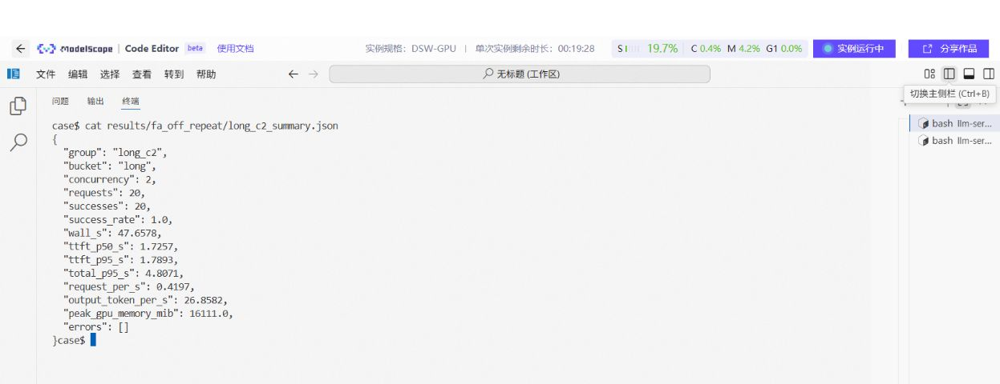
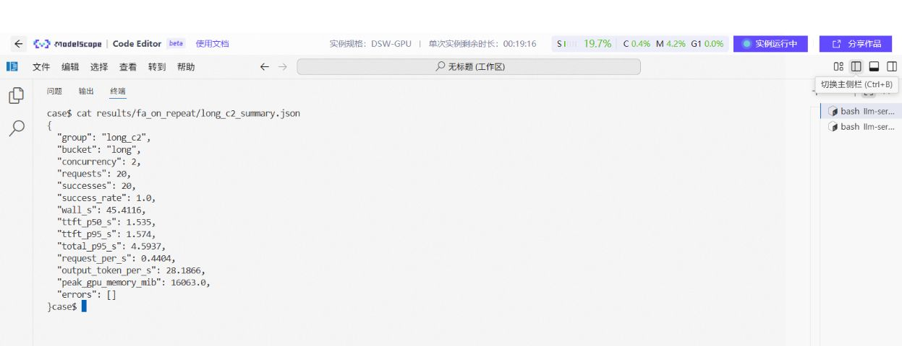

# 09 定位瓶颈，再做一次能解释的优化

[总目录](README.md) · [上一章](08-benchmark-and-quality.md) · [下一章：故障排查](10-troubleshooting.md)

**本章目标：** 提出可验证的原因，用一个变量的对照实验判断收益，同时保留延迟、质量与资源代价。

## 1. 先写假设，再改参数

一次实验记录至少有六项：

```text
现象：长输入时首字等待增加
假设：输入计算或排队影响正在生成的请求
只改一项：开启/调整分块 Prefill
固定条件：模型、模板、负载、输出长度、其他参数
观察：短请求尾延迟、长请求 TTFT、吞吐、内存
决定：按事先门槛保留，或回到基线
```

如果同一轮同时改模型、精度、上下文、并发和后端，即使结果变好，也难以解释是哪项起作用。

## 2. 根据现象选择观察位置

| 现象 | 优先检查 | 候选实验 |
| --- | --- | --- |
| 单路快，高并发首字很慢 | 队列、活跃序列、输入长度 | 限制突发压力、调整调度预算 |
| 每路生成慢，设备频繁读内存 | 带宽、实际卸载、量化执行路径 | 权重量化、后端或分层对照 |
| GPU 有空档，CPU 忙 | tokenizer、调度、采样、同步 | 时间线分析，减少 CPU 热点 |
| 首次慢，之后快 | 文件缓存、JIT、图捕获、前缀缓存 | 分开冷启动、预热与正式测量 |
| 跑一段时间变慢 | 温度、频率、功率、交换 | 持续负载与资源同步采样 |
| 显存不足 | 权重、KV、缓冲、图捕获 | 单独缩减上下文或活跃序列 |

`GPU utilization` 只是观察项。接近 100% 可能仍然每秒只输出少量 token；它不能告诉你模型是否达到任务目标。

## 3. 实例一：A10 的 Flash Attention 开关

固定条件：同一 GGUF、llama.cpp b10430、A10、`-c 4096 -np 2`、客户端并发 2、long 档、每组 20 请求、输出上限 64、温度 0。唯一服务变量为 `-fa off/on`。

| 配置 | 成功 | TTFT P95 s | 完成耗时 P95 s | 输出吞吐 token/s | 采样显存峰值 MiB |
| --- | ---: | ---: | ---: | ---: | ---: |
| off 复测 | 20/20 | 1.7893 | 4.8071 | 26.8582 | 16111 |
| on 复测 | 20/20 | 1.5740 | 4.5937 | 28.1866 | 16063 |

计算方法：

```text
TTFT 降幅 = (1.7893 - 1.5740) / 1.7893 = 12.03%
吞吐增幅 = (28.1866 - 26.8582) / 26.8582 = 4.95%
```



图注：历史 FA off 复测核验。检查分组、请求数与指标，不把 short、long 或不同并发混在一起。 图片仅去除下方空白，命令与输出保持原样；[查看完整原图](../../cases/llama-cpp-flash-attention/figures/04-fa-off-repeat-summary.png)。



图注：与前图对应的 FA on 分组；以上表格可在[公开 CSV](../../cases/llama-cpp-flash-attention/results/observed-summary.csv)中逐行核对。 图片仅去除下方空白，命令与输出保持原样；[查看完整原图](../../cases/llama-cpp-flash-attention/figures/06-fa-on-repeat-summary.png)。

**可以得出的结论：** 该固定短输入、受限生成负载中，on 复测的首字分位数与输出吞吐更好。

**还不能得出的结论：** 所有长上下文都有同样收益；任务质量已经通过；精确节省了 48MiB。long 档实际约 199～229 token，显存每秒采样，部分输出达到长度上限，且公开材料缺少完整原始请求轨迹。

Flash Attention 调整注意力计算与访存组织。收益受序列长度、架构、精度、后端和调度影响，不能给所有模型套同一提升比例。

## 4. 怎样在自己的服务上重做对照

1. 在第 05 章基线服务上完成预热，运行 `baseline_off` 并保存结果。
2. 停止旧服务，确认端口已释放，只修改 FA，启动 `candidate_on`。
3. 用相同输入、请求数、并发、长度与采样重新运行。
4. 再做一次反向顺序复测，观察时序波动。
5. 先检查成功、长度和质量，再算性能差值。

Case 目录中的命令结构：

```bash
python3 scripts/bench.py --workload data/workload.jsonl --output results \
  --config-id baseline_off --concurrency 2 --requests 20 --max-tokens 64
# 停服，只改 -fa on，等模型就绪；然后执行：
python3 scripts/bench.py --workload data/workload.jsonl --output results \
  --config-id candidate_on --concurrency 2 --requests 20 --max-tokens 64
```

这些新目录保存你自己的结果，不能预填成历史成绩。正式业务还应增加真实长度和完整答案测试。

## 5. 实例二：Intel INT4 为什么值得选，但不能只看倍率

同一 Intel 设备的 OpenVINO GenAI 记录使用相同提示、19 输入 token、128 生成 token：

| 项目 | INT4 | INT8 |
| --- | ---: | ---: |
| 制品字节数 | 6,129,582,094 | 9,457,724,353 |
| TTFT ms | 184.02 | 169.73 |
| TPOT ms/token | 47.26 | 98.96 |
| 生成吞吐 token/s | 21.1599 | 10.1047 |

这里 INT4 连续生成约为 INT8 的 2.09 倍，但 TTFT 反而略高。优化是多个指标的取舍；不能把“生成更快”改写成“所有延迟都降低”。

这次两种制品都在思考阶段达到输出上限，尚不能宣布答案质量等价。需要补足完整回答与任务评分，再选择发布版本。16GB 统一内存的容量和资源峰值，也要一起验收。

## 6. 实例三：推测解码提高吞吐，却可能让输出更成批

推测解码先提出候选 token，再由目标模型验证。需要计算草稿成本、接受率、验证成本及额外内存。MTP、草稿模型、DFlash 等具体方案各有实现条件，不是一个可通用复制的开关。

DGX Spark 的两篇 Gemma4 笔记使用同一模型、512 输入/256 输出 token 的随机负载，分别记录 base 与带 assistant 模型的推测配置：

| 客户端并发 / 请求数 | base 吞吐 | 推测吞吐 | base 平均 TTFT ms | 推测平均 TTFT ms |
| --- | ---: | ---: | ---: | ---: |
| 1 / 20 | 20.82 | 30.14 | 488.14 | 462.90 |
| 2 / 40 | 36.87 | 48.92 | 352.24 | 608.22 |
| 4 / 80 | 49.33 | 75.57 | 562.37 | 596.33 |

吞吐单位为输出 token/s。对应转录比值增幅约 44.76%、32.68%、53.19%，不是本轮新测量，也不能外推到其他模型。

并发 1 时，平均 TPOT 从 `46.30ms` 降至 `31.49ms`，工具报告的平均 ITL 却从 `46.12ms` 增至 `78.27ms`。一次可能返回多个 token，用户看到的输出节奏可能更成批。要同时检查流式事件间隔，不能只用平均生成速度代表流畅程度。

原记录接受率约 38%～41%。接受率高低需要结合完整成本判断；没有质量回归、镜像 digest 和逐请求原始文件时，只能作为历史配置实验。原输出中部分“峰值并发/峰值吞吐”字段还有未解释的一致性问题，本体系不使用它们计算结论。

### 6.1 DFlash 的 2.03 倍结果，为什么还需要补测

同一份 DGX Spark DFlash 笔记的后半部分保留了真实对照：同为 `spec_bench`、50 请求、客户端并发 1、总输入 13655 token、总输出 12800 token。baseline 输出吞吐 `21.52 token/s`，DFlash 配置为 `43.74 token/s`，观察比值约 `2.03x`。

但服务参数并不相同：

| 项目 | baseline | DFlash 配置 |
| --- | --- | --- |
| 上下文上限 | 32768 | 8192 |
| 活跃序列上限 | 1 | 8 |
| GPU 内存预算 | 0.70 | 0.85 |
| eager | 显式开启 | 命令未显式开启 |
| 推测解码 | 无 | DFlash，候选数 5 |

所以应写“这两套配置的观察吞吐相差约 2.03 倍”，不能把全部差异归因给 DFlash。补测时先统一其他配置，再只改变推测解码；同时检查首字、流式间隔、接受率、内存和任务质量。原表中的“接受率健康”也需要与草稿和验证成本一起判断。

## 7. 实例四：参数调大，速度没有提升

AMD 395、8060S、Vulkan、Qwen3.6-35B-A3B-BF16 笔记记录：

| 配置变化 | 观察 |
| --- | --- |
| 基础配置 | 约 10.8 token/s |
| 加 FA 和 cache reuse | 仍约 10.8 token/s |
| 缩短上下文，同时增大 batch/ubatch/线程 | 约 10.1 token/s；计算缓冲增加 |

第三组同时改了多个参数，只能记录“这个组合没有改善”，不能归因到某一个参数。FA/cache reuse 的适用性也要细分混合架构中的层和具体实现，不能写成所有 SSM 或混合模型永久无效。

原笔记有“用总模型 65GB 推算每 token 读取量、据此宣布达到理论上限”的解释，这里不采用。该模型是 MoE，**总参数决定主要存储需求，激活专家影响每步计算与访存**；真实执行还受共享层、路由、缓存和 kernel 影响。简单用总文件大小除以标称带宽，不能证明性能已到极限。

同理，“Q4 质量可接受”需要任务评分；“另一档量化预计 65+ token/s”属于预测，不列入实测表。

## 8. 什么时候上 Profiler

当日志和简单对照还无法区分 CPU、设备计算、拷贝或同步问题时，再采时间线。NVIDIA 可使用 Nsight Systems；AMD、Intel、Mac 使用对应工具。

```bash
nsys profile --trace=cuda,nvtx,osrt --output=baseline \
  ./llama-bench -m /srv/models/model.gguf -ngl 99 -p 512 -n 128 -r 3
```

这是具备工具、权限和相应二进制后的命令模板。Profiler 会产生额外开销，不能直接把它的耗时当成无采样基线。先用时间线确认 GPU 空档、拷贝和同步，再针对热点做更细分析。

**本章交付：** 假设、基线、单变量变更、原始证据、收益与代价、保留或回退决定。遇到失败时按[第 10 章](10-troubleshooting.md)定位。
