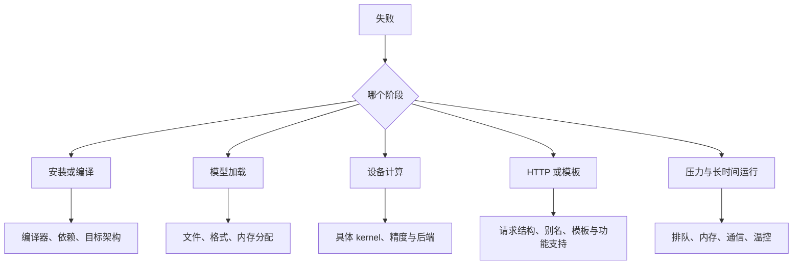

# 10 按失败阶段排查问题

[总目录](README.md) · [上一章](09-profiling-and-optimization.md) · [下一章：多设备](11-parallel-and-scaling.md)

**本章目标：** 从真实错误找到最小失败点，保留证据，再做范围明确的修复。先定位层次，避免一遇到问题就重装整套环境。

## 1. 先写清失败发生在哪里



每次至少记录：精确命令、版本、输入、错误时间、首个关键错误、是否稳定复现、最后一次可用配置。Python 最后的 `EngineDeadError` 往往只是结果，应往前找第一个设备或模型错误。

## 2. 编译失败：工具更新了，为什么还是旧版本

FlowUs 的 vLLM Conda 编译记录中，曾更新 CMake 后仍调用旧程序，也出现过缺少 `packaging`、`setuptools_scm` 和构建内存不足。

先检查当前环境：

```bash
command -v python
python --version
python -m pip --version
command -v cmake
cmake --version
python -m pip check
```

如果 Shell 缓存了旧路径，Bash 可在确认新程序已正确安装后执行 `hash -r` 再检查。Notebook Kernel 与终端环境不同，也可能出现“终端装了，单元格仍找不到”。

缺包按固定源码的构建依赖补齐。旧笔记里的 `torch==2.1.0`、`numpy<2` 等属于当时版本组合，不能成为所有新版本的固定处方。

编译进程被系统杀死时，要查主机内存和系统日志。降低 `MAX_JOBS` 或 `-j` 可以减轻并行构建内存，但不能解决缺失头文件或错误架构。

## 3. GB10：具体指令不支持目标架构

原始错误摘录：

```text
Instruction 'cvt with .e2m1x2' not supported on .target 'sm_121'
```

排查顺序：

1. 保存完整编译命令，确认是哪个源码文件和 kernel 失败。
2. 核对设备能力、NVCC/PTXAS 版本、PyTorch 构建与 CPU 架构。
3. 确认该 kernel 是否是当前模型需要的精度路线。
4. 查固定版本的架构条件、构建选项或上游修复。
5. 修复后先跑最小算子和小请求，再启动目标模型。

旧记录里的 `TORCH_CUDA_ARCH_LIST=12.0` 是特定尝试，不能当成万能办法。改变目标并不能保证所有架构专有指令都可运行。要保存最终构建日志和设备测试，才能写“已解决”。

## 4. 文件存在但模型加载失败

| 错误 | 首先检查 | 最小验证 |
| --- | --- | --- |
| 找不到 config/tokenizer | 挂载源、容器内路径、文件清单 | 在运行环境内列文件 |
| missing tensor | 引擎与转换分支、模型 revision | 用匹配制品重试加载 |
| unknown architecture | 固定框架是否支持结构 | 查支持表和源码版本 |
| 哈希不符、文件末尾错误 | 未完成下载、错误下载页、分片 | 重做校验，不继续推理 |

Mac 笔记出现过 `missing tensor 'hc_head_base'`，涉及不同 DeepSeek V4 分支与 GGUF 命名。应把引擎、转换工具和模型制品视为一个匹配组合；不能因为扩展名都叫 GGUF 就混用。

Docker 场景的只读检查模板：

```bash
docker exec edge-vllm ls -l /models/model/config.json
docker logs --tail 120 edge-vllm
```

这里假定第 07 章的容器名和挂载位置。日志公开前筛掉私有路径、地址和请求内容。

## 5. 编译成功，执行 kernel 时失败

Mac 特定分支与 FP4/FP8 制品的错误：

```text
ggml-metal-device.cpp:876: not implemented
Asserting on type 42
ggml_metal_library_get_pipeline_mul_mm_id_map0
```

这与“编译工具没装”不同。程序已经运行到不支持的张量类型或 kernel。应核对该分支后端的实现范围，选受支持的模型制品，或使用有对应实现的引擎。

Intel 记录也有相似层次差异：OpenVINO 可以枚举 CPU/GPU/NPU，llama.cpp OpenVINO 后端也可以构建，但当前 Qwen3.5 GGUF 在建图时遇到 `cache_r_l0` / `CPY` 不支持。后续成功的路线是 OpenVINO GenAI + 对应 IR。设备枚举、引擎构建、模型执行需要分别记录。

## 6. AMD：dmesg 显示 120000M，模型却只能看见约 63GiB

五机 RPC 笔记保留过：

```text
GTT size has been set as 125829120000 but TTM size has been set as 66286690304, this is unusual
ROCm0: AMD Radeon Graphics (63215 MiB, ...)
```

目标大分配为：

```text
buffer of size 87013675008
```

约 81GiB 的分配大于设备报告的约 61.7GiB，所以失败有直接容量证据。不能只看 dmesg 中另一行 `120000M of GTT memory ready` 就判断容量已生效。

只读检查顺序：

```bash
uname -r
cat /proc/cmdline
dpkg-query -W 'amdgpu-dkms' 2>/dev/null
modinfo amdgpu | grep -E 'filename:|version:|vermagic:'
./build-hip/bin/llama-cli --list-devices
```

原记录定位到特定 DKMS 模块与 TTM 限制，后续可用组合为内核 `6.17.0-35-generic`、ROCm 7.2.1、llama.cpp `b9557-0f7fada56`。这属于该批设备的诊断，不能推广为“所有 AMD 都应卸载 DKMS”。内核、驱动和启动参数的变更按本机受支持组合处理，并保留恢复途径。

本章只提供读取与判断方法，不提供一个自动改内核的通用脚本。

## 7. 请求 200，但一直思考、没有最终答案

vllm-metal 笔记中：文本能生成，`finish_reason` 为 `length`，输出停在思考阶段。模型目录的模板字段与实际 `chat_template.jinja` 还存在差异。

按下面顺序检查：

1. 实际使用哪个模板？是否与模型匹配？
2. 模板默认是否启用思考？请求参数是否被模板接收？
3. 输出上限是否在最终答案前耗尽？
4. 服务默认 generation config 是否覆盖了预期采样？
5. 在足够输出长度下，固定问题能否完整回答？

该插件版本的记录中使用过显式模板与 `enable_thinking=false`。这是特定模型/模板参数，不是所有模型的通用字段。不要简单添加一句“禁止思考”就认为模板与停止条件已经正确。

## 8. 文本成功，图片请求 500

原记录关键错误：

```text
NotImplementedError: Multimodal encoder execution is not wired on Metal yet.
```

前端解析图片成功，并不等于后端能执行视觉 encoder。该版本随后还出现引擎退出，必须先恢复服务，再决定拒绝不支持的输入或切换经过验证的多模态路线。

功能矩阵应明确写为：文本通过，图片失败。升级插件后也要分别回归，不能照抄旧版本结论。

## 9. 服务越压越慢，或者跑一会儿才变慢

| 现象 | 证据 | 下一步 |
| --- | --- | --- |
| 请求最终成功，TTFT 持续上升 | 队列、客户端并发/到达率 | 降低压力，测容量拐点 |
| 内存不断增长 | 请求/采样时间关联、缓存与进程 RSS | 区分正常缓存、碎片和泄漏 |
| 磁盘忙、交换增长 | 系统内存、swap、磁盘吞吐 | 缩小制品/并发，验证工作集 |
| 温度上升后速度下降 | 温度、频率、功率、分段吞吐 | 在持续负载下重新验收 |
| 多卡或多节点挂住 | 通信最小测试、rank 日志 | 按第 11 章拆分控制面与数据面 |

RTX 2060 笔记中 GPU 接近满载，但混合推理生成约 5.26 token/s，同时记录了高主机内存与交换活动。该记录足以提醒我们检查资源压力；还不能仅凭百分比认定唯一瓶颈。

**本章交付：** 最小复现、首个关键错误、根因证据、范围明确的修复和回归结果。多设备问题继续[第 11 章](11-parallel-and-scaling.md)。
