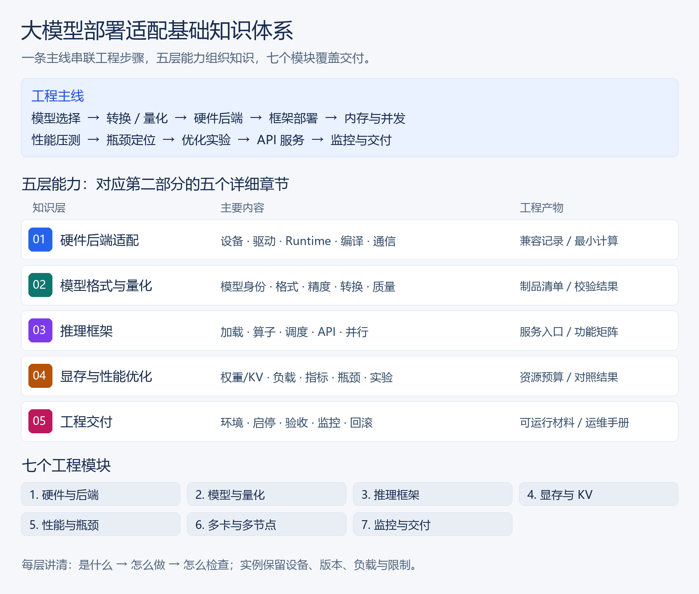

# 大模型部署适配基础知识体系

> 适用定位：大模型部署工程师 / 推理优化工程师 / 多硬件适配工程师。
>
> 核心目标：掌握模型适配、推理服务部署、显存分析、性能压测、瓶颈定位和交付闭环。

本体系沿用原稿的章节安排：**整体知识地图 → 五层能力详细框架 → 核心概念 → 项目复盘 → 知识库目录 → 故障速查 → 附录**。先讲清知识关系，再在每层展开原理、操作与实例。

## 0. 总体定位

一份完整部署需要回答：模型能否在目标设备正确执行？内存是否够？目标负载下是否足够快？功能和质量是否合格？其他人能否安装、运行和维护？

主线是：

```text
模型选择 → 格式转换 / 量化 → 硬件后端适配 → 推理框架部署
 → 显存与并发配置 → 性能压测 → 瓶颈定位 → 参数优化
 → 服务化接口 → 监控与交付
```



图注：五层能力对应第二部分的五个章节。七个工程模块贯穿其中；正文按问题深入，项目实践按部署主线执行。[查看 SVG](assets/deployment-workflow.svg)。

## 第一部分：整体知识体系地图

[一条主线、七个模块与五层能力](01-knowledge-map.md)

理解各层负责什么、交接什么，以及模型、设备、服务与验收怎样关联。第一次阅读从这一部分开始。

## 第二部分：五层能力详细框架

| 层次 | 章节 | 主要子章节 |
| --- | --- | --- |
| 第 1 层 | [硬件后端适配层](02-capability-layers/01-hardware-backends.md) | 平台地图、兼容链、环境采集、NVIDIA/AMD/Intel/Apple/昇腾、源码编译、多设备通信 |
| 第 2 层 | [模型格式与量化层](02-capability-layers/02-model-formats-quantization.md) | 模型制品、格式/精度/方法、选择、下载校验、转换、GGUF/IR、权重与 KV 量化、质量回归 |
| 第 3 层 | [推理框架层](02-capability-layers/03-inference-frameworks.md) | 框架定位、vLLM 结构与启动、llama.cpp 构建与运行、OpenVINO、MLX、API 与模板、并行选择 |
| 第 4 层 | [显存与性能优化层](02-capability-layers/04-memory-performance.md) | 资源预算、KV、上下文与并发、指标、负载、压测、瓶颈分析、量化/缓存/推测解码实验 |
| 第 5 层 | [工程交付层](02-capability-layers/05-engineering-delivery.md) | 七项产物、目录、环境封装、API 验收、启停、监控、稳定性、发布与回滚 |

五层是知识分类。做项目时仍按上面的部署主线前进，不必把某一层全部学完后才开始操作。

## 第三部分：核心概念解释库

[概念解释与工程验证](03-core-concepts.md)

按原稿展开 vLLM、PagedAttention、KV Cache、Continuous Batching、Chunked Prefill、Prefix Cache、TP、PP、GGUF 和框架选型，并补充量化执行、Flash Attention、推测解码与统一内存的常见误读。

## 第四部分：项目复盘模板

[标准项目复盘与多硬件适配记录](04-project-review.md)

保留原稿“项目背景 → 环境 → 模型 → 框架 → 方案 → 问题 → 排查 → 优化 → 压测 → 结论”的结构，给出每项该填什么，以及一份根据 Intel 部署记录填写的节选。

## 第五部分：个人知识库目录设计

[项目、概念、实验与故障怎样归档](05-knowledge-base.md)

沿用原稿的七个问题：它是什么、解决什么问题、在项目哪里用到、常用参数、常见故障、怎样排查、怎样用数据证明。

## 第六部分：故障排查速查表

[按安装、构建、加载、执行、接口和压力分层排查](06-troubleshooting.md)

先给速查表，再用 GB10 编译、AMD 运行时内存、Intel NPU/IR、Metal 模型类型与流式输出等记录解释排查路径。

## 附录

- [附录 A：常用命令速查](appendices/commands.md)：环境、构建、API、压测、监控和多卡通信。
- [附录 B：参考资料与知识修订](appendices/references.md)：官方入口、版本边界及原稿修订。
- [工程笔记来源与实测转录](evidence/README.md)：按实例编号查来源、条件和数据缺口。
- [原始知识框架图](assets/edge-llm-deployment-framework-original.png)：保留作者原图；概念分类按正文修订。

## 实例怎样使用

正文采用 FlowUs 中的相关部署工程作为参考。实例先说明环境与目标，再给操作与结果，最后解释它能支撑什么判断。相同实例的完整参数与数据集中在来源目录，各章节只引用与当前知识点有关的部分。

| 你要学什么 | 正文采用的工程参考 |
| --- | --- |
| 新架构与编译配套 | DGX Spark GB10、ARM64、CUDA 与 vLLM 源码 |
| 端侧后端选择 | Intel 16GB 设备的 OpenVINO/Vulkan/SYCL 对比 |
| GGUF 与量化转换 | GB10 Qwen3-30B-A3B 转换、GGUF 量化与 Ollama 导入记录 |
| 共享内存与多机容量 | AMD 395 五机 HIP RPC 的 GTT/TTM 排障 |
| 服务调度与并发 | oMLX 并发分组、vLLM 200 请求记录 |
| 推测解码的收益与代价 | Gemma MTP 与 DFlash 参数对照 |
| 后端功能验收 | vllm-metal 文本/图片结果、Intel IR 多模态记录 |

本次整理不把历史数字写成本轮新测试。命令模板注明前提，教学算例明确假设，缺少原始文件的记录保留缺口。可运行[离线核查](examples/verify_records.py)重新计算已转录数据；它不执行模型推理。

更新日期：**2026-10-18**。
