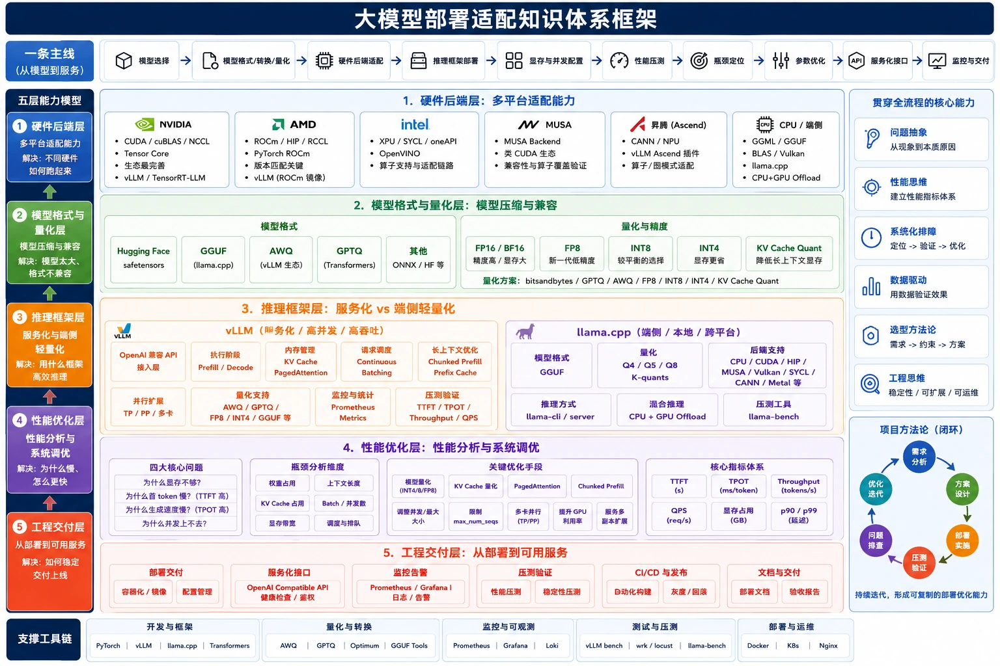

# 大模型部署知识体系
**简体中文** | [English](../en/README.md)

面向大模型部署、端侧推理、性能优化与服务交付。全书按教程卷、实例卷和证据卷组织：教程卷解释机制与判断方法，实例卷记录设备执行过程，证据卷保留 R01–R50 原文、E01–E20 条件和结构化测量。

**[完整目录](SUMMARY.md) · [硬件实例](cases/README.md) · [环境与数据约定](00-preface.md) · [独立 Case](../../cases/README.md) · [仓库首页](../../README.md)**

## 2026-10 当前部署与优化

按对应能力层阅读：[当前引擎](chapters/frameworks/serving-engines.md) · [MTP](chapters/performance/speculative-decoding.md) · [DSpark完整流程](chapters/performance/dspark.md) · [量化工程](chapters/models/quantization.md) · [PD与MoE](chapters/performance/disaggregated-serving.md) · [DGX Spark](chapters/hardware/dgx-spark.md) · [通用性能优化测试方法论](engineering/edge-llm-performance-methodology.md) · [项目文档索引](engineering/projects/README.md)。

[更新说明与官方资料](evidence/2026-10-refresh.md)记录源码快照和支持限制。[压测章节](chapters/performance/benchmarking.md)提供可执行矩阵；新GPU方案标注为官方参考流程，实际性能继续引用原始测量条件。

## 先认识硬件与计算软件栈

| 平台 | 硬件和软件怎样配合 | 基础介绍 |
| --- | --- | --- |
| NVIDIA | GPU执行并行计算，CUDA平台提供运行时、工具与计算库 | [GPU、CUDA Runtime/Toolkit、cuBLAS、NCCL](chapters/hardware/nvidia.md) |
| AMD | Radeon/Instinct/集成GPU通过ROCm/HIP或其他后端执行 | [GPU架构、ROCm、HIP、计算库与RCCL](chapters/hardware/amd.md) |
| Mac | Apple Silicon共享内存；Metal调用GPU，MLX在其上实现机器学习运算 | [统一内存、Metal、MLX与MLX-LM](chapters/hardware/apple.md) |
| Intel | CPU/GPU/NPU通过对应工具链、运行时与设备插件执行 | [oneAPI、SYCL、Level Zero与OpenVINO](chapters/hardware/intel.md) |
| 昇腾 | AI加速器通过CANN和上层框架/服务引擎执行 | [芯片、运行时、算子、HCCL与插件](chapters/hardware/ascend.md) |

先看[CPU/GPU/NPU、内存与软件层级](02-capability-layers/01-hardware-backends.md)，再进入对应平台。CUDA、ROCm是计算软件平台；Metal是GPU API；MLX是机器学习框架，它们的层级和职责不同。

## 工程主线

```text
模型选择 → 格式转换/量化 → 硬件后端适配 → 引擎构建与部署
 → 权重/KV/工作区预算 → 功能基线 → 性能压测 → 瓶颈定位
 → 单项或组合优化 → API/监控 → 交付与回滚
```

知识体系回答“是什么、为什么、怎样选择、怎样执行、怎样判断效果”。平台操作解释环境与命令，硬件实例展示真实过程和结果。学习主线是硬件/软件栈 → 模型制品 → 推理执行 → 性能瓶颈 → 服务交付。

## 一、知识体系目录

| 部分 | 阅读入口 | 内容 |
| --- | --- | --- |
| 第一部分 | [整体知识体系地图](01-knowledge-map.md) | 硬件、软件栈、模型与引擎的关系，一次生成的执行链 |
| 第二部分 | [五层能力框架](02-capability-layers/README.md) | 硬件、模型、框架、性能、交付，细分入口见下表 |
| 第三部分 | [核心概念解释库](03-core-concepts.md) | 十个核心机制及参数影响 |
| 第四部分 | [项目复盘模板](04-project-review.md) | 环境、部署、排错、优化和验收十项记录 |
| 第五部分 | [个人知识库目录设计](05-knowledge-base.md) | 八个主题目录与工程资料组织 |
| 第六部分 | [故障排查速查表](06-troubleshooting.md) | 按失败阶段定位、验证和回归 |

### 五层能力与技术专题

| 能力层 | 重点 | 详细专题 |
| --- | --- | --- |
| [1. 硬件与运行时](02-capability-layers/01-hardware-backends.md) | CPU/GPU/NPU、容量与带宽、驱动、Runtime、计算库 | [NVIDIA](chapters/hardware/nvidia.md) / [AMD](chapters/hardware/amd.md) / [Intel](chapters/hardware/intel.md) / [Apple](chapters/hardware/apple.md) / [昇腾](chapters/hardware/ascend.md) |
| [2. 模型格式与量化](02-capability-layers/02-model-formats-quantization.md) | 制品身份、HF/GGUF/IR、W/A/KV 精度、质量 | [GGUF 转换](chapters/models/gguf-conversion.md) / [量化选择](chapters/models/quantization.md) / [Ollama 操作](appendices/gguf-ollama.md) |
| [3. 推理框架](02-capability-layers/03-inference-frameworks.md) | 构建、加载、上下文、调度、API | [vLLM](chapters/frameworks/vllm-service.md) / [llama.cpp](chapters/frameworks/llama-cpp.md) / [OpenVINO](chapters/frameworks/openvino.md) |
| [4. 显存与性能优化](02-capability-layers/04-memory-performance.md) | KV、prefill/decode、并发、延迟、吞吐 | [压测](chapters/performance/benchmarking.md) / [缓存与调度](chapters/performance/cache-scheduling.md) / [多卡多机](chapters/performance/parallelism.md) / [推测解码](chapters/performance/speculative-decoding.md) |
| [5. 工程交付](02-capability-layers/05-engineering-delivery.md) | 环境封装、接口、监控、验收、回滚 | [环境与启停](chapters/delivery/environment-operations.md) / [API 与监控](chapters/delivery/api-monitoring.md) |

## 二、硬件部署适配与优化实例

完整测试条件和证据状态见[实例矩阵](cases/README.md)。每个入口集中保存同一平台的部署、参数调整、实际结果和限制。

| 平台 | 实例入口 | 工程重点 |
| --- | --- | --- |
| NVIDIA | [RTX2060](cases/C01-rtx2060/README.md) | CUDA、量化制品、CPU/GPU 混合卸载 |
| NVIDIA | [RTX4080 / A6000 双卡](cases/C02-dual-4080/README.md) | TP、PCIe、显存预算、服务调参 |
| NVIDIA | [GB10 文本推理](cases/C03-gb10/README.md) | ARM64 构建、FP8、AWQ、MTP、DFlash |
| NVIDIA | [GB10 多模态](cases/C04-gb10-multimodal/README.md) | VL、Omni、Docling、输入预算 |
| AMD | [Radeon 780M](cases/C05-radeon-780m/README.md) | Windows HIP、Ollama、回退与共享内存 |
| AMD | [Radeon 8060S](cases/C06-radeon-8060s/README.md) | Vulkan、Q4/BF16、CPU→GPU→参数优化 |
| AMD | [395 五机 RPC](cases/C07-amd-395-rpc/README.md) | HIP RPC、GTT/TTM、构建分发与权重切分 |
| AMD | [W7900 多卡多节点](cases/C08-w7900/README.md) | ROCm/RCCL、Ray、TP/PP、通信排查 |
| Intel | [Arc GPU / NPU](cases/C09-intel-arc-npu/README.md) | Vulkan/SYCL/IR 对照、ASR/TTS、设备分工 |
| Apple | [M3 Ultra Metal](cases/C10-m3-metal/README.md) | GGUF、Metal 构建、制品兼容性排错 |
| Apple | [M3 Ultra MLX / oMLX](cases/C11-m3-mlx/README.md) | 模板、APC、视觉、并发对照 |
| 昇腾 | [310P3](cases/C12-ascend-310p/README.md) | CANN、模型插件、FP16/TP2、压测 |
| MUSA | [适配与优化流程](cases/C13-musa/README.md) | Toolkit、构建、GPU 卸载、API；待设备实测 |
| CPU | [Windows 顺序演练](cases/C14-windows-cpu/README.md) | 固定制品、完整服务、功能/异常/性能验收 |

## 三、命令、模板与证据

| 用途 | 入口 |
| --- | --- |
| 执行前核对 | [环境与数据约定](00-preface.md) |
| 命令查询 | [常用命令](appendices/commands.md) / [压测工具与完整命令](appendices/benchmark-tools.md) |
| 工程记录 | [适配模板](templates/adaptation-record.md) / [实验模板](templates/experiment-record.md) / [复盘模板](templates/deployment-review.md) |
| 历史数据 | [测量条件与说明](evidence/records/README.md) / [测量 JSON](evidence/measurements.json) |
| 数据核算 | [核算程序](examples/verify_records.py) / [核算输出](examples/verified-output.txt) |
| 来源追溯 | [文章与章节映射](evidence/chapter-sources.md) / [50 份技术记录清单](evidence/source-coverage.json) |
| 参考资料 | [官方文档与技术修订](appendices/references.md) |

## 四、目录结构与阅读方式

```text
01-deployment-foundations/
├── README.md               当前版本首页
├── SUMMARY.md              详细目录
├── 00-preface.md            环境与数据约定
├── 01-knowledge-map.md      工程地图
├── 02-capability-layers/    五层能力框架
├── 03～06-*.md             概念、复盘、资料组织、排错
├── chapters/               各技术专题
├── engineering/            方法论、项目文档与兼容入口
├── cases/                  C01～C14 设备实例与可执行材料
├── evidence/               R01～R50 原文、E记录与测量文件
├── meta/                   证据政策、指标口径与冲突记录
├── templates/              适配、实验、复盘模板
├── examples/               辅助程序
├── assets/                 框架图与公开样例
├── appendices/             命令与参考资料
└── book.html               可下载的离线检索版
```

GitHub 阅读从本页和[完整目录](SUMMARY.md)进入。离线检索可下载 [book.html](book.html) 后用浏览器打开；正文更新后按[构建说明](../../tools/README.md)重新生成。

独立 Case 的正文、脚本、输入、截图与结果统一放在仓库的 [`cases/`](../../cases/README.md)，从[Case 目录](../../cases/README.md)访问。

## 资料状态

50 份技术记录保留可公开的操作步骤、版本、参数、日志和测试表，私人路径、节点与认证信息脱敏。GPU/NPU 的历史成绩按原条件引用，缺失证据和失败保留说明；MUSA 尚无实测记录。框架图中的分类与简写以[技术修订](appendices/references.md)为准。

更新时间：**2026-10-19**
