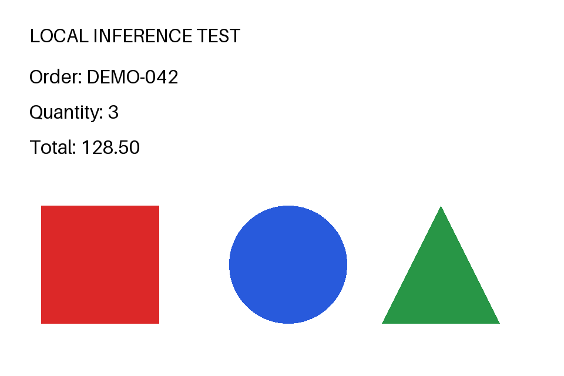

# vLLM：从模型目录到可测量的推理服务

**完整工程记录：** [GB10构建与量化加速](../../engineering/nvidia-gb10.md) · [双4080/A6000](../../engineering/nvidia-dual-gpu.md) · [W7900](../../engineering/amd-w7900.md) · [昇腾310P3](../../engineering/ascend-310p.md)

[总目录](../../SUMMARY.md) · [所属总章：推理框架](../../02-capability-layers/03-inference-frameworks.md) · [压测方法](../performance/benchmarking.md)

## 本章概览

服务部署的目标，是让应用通过稳定接口得到完整答案，并知道当前服务能承受什么负载。安装成功只是起点。还要检查制品、后端、模板、内存、正常与异常请求，最后才进入压测。

本章沿用作者FlowUs的GB10/Qwen FP8工程。历史环境为DGX Spark GB10、ARM64、128GB、Ubuntu24.04、CUDA13，以及vLLM提交`17d87168d`。它提供真实构建问题、启动参数和200请求汇总；模型revision和完整依赖锁没有随原记录保存，因此以下是历史工程的操作整理，不承诺在任意新环境逐字复现旧数字。本轮没有重新执行该GPU工程。

## 1. 先固定环境与模型身份

先看CPU架构、驱动与工具链，再决定使用配套镜像还是源码。ARM64设备不能直接套用x86_64的wheel；CUDA驱动兼容也不表示所有依赖库、kernel或模型结构都已经支持。

```bash
uname -m
nvidia-smi
nvcc --version
python --version
python -m pip show torch vllm
```

源码路线要先按该提交的构建要求准备PyTorch、编译器和CUDA依赖。原笔记没有完整安装锁，因此这里不能凭空补成“只运行一条pip命令就能安装全部环境”。在可工作环境里至少保存`pip freeze`、PyTorch版本、编译配置和CMake日志。

历史源码准备顺序如下：

```bash
git clone https://github.com/vllm-project/vllm.git
cd vllm
git checkout 17d87168d
git submodule update --init --recursive
export CUDA_HOME=/usr/local/cuda-13.0
export PATH="$CUDA_HOME/bin:$PATH"
export LD_LIBRARY_PATH="$CUDA_HOME/lib64:${LD_LIBRARY_PATH:-}"
export VLLM_TARGET_DEVICE=cuda
export MAX_JOBS=8
```

原记录为绕开特定FP4 kernel的编译错误，使用`TORCH_CUDA_ARCH_LIST="12.0"`后执行`python -m pip install --no-build-isolation -e .`。设备本身的计算能力仍为12.1。这个绕过属于特定提交和kernel路径，不应复制成所有GB10的默认构建规则。详细错误见[NVIDIA专题](../hardware/nvidia.md)。

模型放在`/srv/models/Qwen3.6-35B-A3B-FP8`。这是本文统一改写的公开目录，需包含权重、配置与匹配tokenizer；不是下载地址。新复现应先从模型的公开页面确认准确仓库、revision和许可，保存制品清单后继续。

## 2. 用小预算完成首次启动

首次启动的目标是加载、短请求和日志检查，先不把最大上下文、活动序列和内存比例同时拉高。下面保留同一模型别名，使用较小的起步预算：

```bash
vllm serve /srv/models/Qwen3.6-35B-A3B-FP8 \
  --served-model-name Qwen3.6-35B-A3B-FP8 \
  --host 127.0.0.1 --port 8001 \
  --tensor-parallel-size 1 \
  --max-model-len 4096 \
  --max-num-seqs 1 \
  --gpu-memory-utilization 0.80
```

这是教学起步配置，不是后面历史性能表对应的配置。前台启动可以直接看到错误；在第二个终端发请求。出现加载错误时，先保存首次异常与环境，避免立刻加入多个优化参数让问题更难定位。

依次检查：实际识别的模型结构与dtype、量化kernel、attention后端、权重内存、KV容量、图编译与warm-up是否完成、服务是否ready。`gpu-memory-utilization`是引擎内存预算比例，不是设备算力利用率，也不是严格限制其他进程内存的隔离机制。

## 3. API 检查要分四步

第一步检查健康与模型身份：

```bash
curl --fail-with-body http://127.0.0.1:8001/health
curl --fail-with-body http://127.0.0.1:8001/v1/models
```

第二步保存一条非流式请求的完整响应：

```bash
curl --fail-with-body http://127.0.0.1:8001/v1/chat/completions \
  -H 'Content-Type: application/json' \
  -d '{"model":"Qwen3.6-35B-A3B-FP8","messages":[{"role":"user","content":"用三句话说明KV缓存的作用。"}],"max_tokens":256,"temperature":0,"stream":false}' \
  -o response.json
```

核对`choices`、正文、`finish_reason`与usage。若到达长度上限而没有最终答案，就增加合理预算或按模型支持的方法管理思考，不能将“生成了一段文本”当作完整任务通过。

第三步改成`stream:true`并使用`curl -N`，检查SSE事件、增量正文、结束事件和客户端取消。首个角色事件通常没有正文，客户端TTFT应采用明确口径。

第四步测试错误模型名、空消息、畸形JSON和超长输入，记录HTTP状态、错误类型及之后的健康。错误返回不能泄露路径；服务也不应因为一个坏请求退出。异常行为按固定版本实测，不凭接口兼容声明填写“通过”。

## 4. 再恢复历史负载配置

以下重现原记录的关键性能参数，主机监听改为本地回环；它们是已运行历史配置，不能代替每台设备的容量预算：

```bash
vllm serve /srv/models/Qwen3.6-35B-A3B-FP8 \
  --served-model-name Qwen3.6-35B-A3B-FP8 \
  --host 127.0.0.1 --port 8001 \
  --max-model-len 16184 \
  --max-num-batched-tokens 8192 \
  --max-num-seqs 4 \
  --gpu-memory-utilization 0.80 \
  --generation-config auto \
  --override-generation-config '{"temperature":0.6,"top_p":0.95,"top_k":20}' \
  --kv-cache-dtype fp8 \
  --load-format auto \
  --attention-backend flashinfer \
  --enable-prefix-caching \
  --enable-chunked-prefill
```

源命令另有`trust-remote-code`。它只在固定模型确有需要且已经审阅代码时启用，不作为通用默认。移除或增加这类选项都应记录到新运行，不能说改写后的命令已经重新测过。

这里同时启用了FP8 KV、Prefix Cache和Chunked Prefill。历史报告说明整套配置能够完成该负载，没有提供逐项关闭的对照，所以不能分别给每个开关分配提升百分比。

## 5. 跑一次有保存位置的压测

历史负载是200请求、随机输入目标2048、输出128、到达率inf、seed42。新运行补上结果目录与明细保存：

```bash
mkdir -p results/gb10-fp8-burst
vllm bench serve \
  --backend openai-chat \
  --base-url http://127.0.0.1:8001 \
  --endpoint /v1/chat/completions \
  --model Qwen3.6-35B-A3B-FP8 \
  --tokenizer /srv/models/Qwen3.6-35B-A3B-FP8 \
  --dataset-name random \
  --random-input-len 2048 --random-output-len 128 \
  --num-prompts 200 --request-rate inf --seed 42 \
  --save-result --save-detailed \
  --result-dir results/gb10-fp8-burst
```

根据固定版本的`vllm bench serve --help`核对参数。随机输入目标不等于模板处理后的实际输入总数，输出也可能被EOS、思考或长度上限影响，应以明细和usage为准。

原记录200成功、0失败，总输出25600token、总时间297.46秒，输出吞吐86.06token/s。平均TTFT148430.70ms，P99 TTFT293115.24ms。活动序列上限4与客户端突发200请求是两个层面，多余请求会等待；高TTFT提示该突发模式下交互体验很差。

不能把它写成“200并发都在GPU同时计算”，也不能用这个结果代表低负载首token延迟。下一步应补有限并发与受控到达率，找出满足目标TTFT和尾延迟的工作点。具体流程见[压测章节](../performance/benchmarking.md)。

## 6. 停止、恢复与完成标准

前台服务用Ctrl+C停止，确认端口与进程已经退出；不要用模糊进程名批量终止其他模型。服务由systemd或容器管理时，用对应实例的停止命令。

本章的可交付结果应包含：固定环境与模型身份、最终命令、启动日志、正常和异常请求、逐请求性能数据、资源采样与结论。历史工程提供了其中一部分，新部署时要补齐。部署成功应写明通过的模型、功能、长度和负载范围，让下一位工程师知道从哪里继续。

## 七、从图片文件到流式答案的完整链路

本节沿用FlowUs中GB10部署Qwen3-VL-8B的工程方式，把原来的本地图片base64与SSE片段整理成可独立使用的程序。示例图片改为仓库生成的公开测试卡，避免要求读者寻找私人输入。

### 7.1 先画清楚执行链路

```text
本地PNG → 字节/摘要 → base64 data URL → chat请求
 → 服务解析 → processor与图像token → 视觉encoder
 → 语言模型生成 → SSE增量 → answer.txt与事件记录 → 内容验收
```

每一段都可能失败。HTTP400先检查字段与输入限制；权重加载成功但图片500要查processor/encoder；流已开始却不结束，要看生成上限、客户端与引擎。不要把所有错误都处理成“再增大max_model_len”。

### 7.2 准备有答案的公开图像

在仓库根目录执行，使用Pillow生成960×640测试卡：

```bash
python -m pip install Pillow==12.1.1
python docs/01-deployment-foundations/examples/make_vision_input.py \
  --output docs/01-deployment-foundations/assets/vision-input
```



图注：程序生成的公开输入，包含四行文字和红色正方形、蓝色圆形、绿色三角形；这是测试输入，不是模型运行截图。对应[期望字段与摘要](../../assets/vision-input/expected.json)。

检查项为标题、编号DEMO-042、数量3、金额128.50，以及三个图形的顺序与颜色。文字识别与图形识别分开记录。要求模型读不到就说明不确定，避免把补全文本当成成功。

### 7.3 使用原工程的单模型入口

先准备与ARM64/GB10配套的镜像和Qwen3-VL-8B完整目录，确认processor、模板与权重匹配。在配套容器内启动，保留原memory0.8、端口8007，并以ctx8192、seqs1作为新增冒烟预算：

```bash
vllm serve /srv/models/Qwen3-VL-8B \
  --served-model-name qwen3-vl-8b \
  --host 127.0.0.1 --port 8007 \
  --tensor-parallel-size 1 \
  --max-model-len 8192 --max-num-seqs 1 \
  --gpu-memory-utilization 0.80
```

该冒烟预算不等于原历史性能配置。本节提供可运行材料与验收方法，没有给新测试卡配上历史模型输出。模型是否需要额外模板或代码选项，按固定制品与版本检查。

服务ready后，先用纯文本短题，再发图片。这样可确认新增故障是否由视觉路径引起。原Qwen3-VL30B记录设置过100000/131072上下文；这不代表本节输入需要那么大，也没有相应长图文质量结果。

### 7.4 发起请求并保存全过程

仓库提供[vision_client.py](../../examples/vision_client.py)，只用Python标准库。客户端会读取图像、生成data URL、保存request.json，接收SSE并记录事件到达时间，最后保存answer.txt与summary.json。

```bash
python docs/01-deployment-foundations/examples/vision_client.py \
  --url http://127.0.0.1:8007/v1/chat/completions \
  --model qwen3-vl-8b \
  --image docs/01-deployment-foundations/assets/vision-input/vision-card.png \
  --max-tokens 512 --output results/qwen-vl-card
```

请求的关键结构如下；脚本自动填写data URL，不需要手工拼接base64：

```json
{
  "model": "qwen3-vl-8b",
  "messages": [{"role": "user", "content": [
    {"type": "text", "text": "逐行读取全部文字，再描述图形。"},
    {"type": "image_url", "image_url": {"url": "data:image/png;base64,..."}}
  ]}],
  "temperature": 0,
  "max_tokens": 512,
  "stream": true
}
```

`...`仅用于解释结构，真实请求必须使用完整字节。远程调用时客户端本地文件路径对服务端不可见，data URL解决输入传输；发送文件名字符串不会自动上传图片。

### 7.5 怎样读取保存的结果

| 文件 | 检查内容 |
| --- | --- |
| request.json | 模型名、prompt、图片字段与输出上限 |
| events.jsonl | 每个data事件、相对到达时间和结束标记 |
| answer.txt | 实际文字、数字、图形与幻觉 |
| summary.json | HTTP状态、首正文时间、结束原因、usage（服务提供时） |
| server.log，另行保存 | processor、图像token、encoder和引擎错误 |

脚本的first_content_s是“首次非空正文片段”，不是图像encoder耗时，也不把空role事件算首token。一次SSE片段可能含多个token，因此不会从片段数伪造token/s。服务没有发送usage时字段为null，不能用字符数补造token计数。

`finish_reason=length`表示到达预算，需检查最后一句和所有验收项；只有HTTP200不够。识别通过也不证明复杂表格、手写、多页PDF已经通过，应逐步增加难度与对应真值。

### 7.6 复用于Mac服务时改哪些地方

本体系另一路历史MLX-VLM使用`type=input_image、image_url为字符串`，脚本提供`--image-style mlx`对应该协议。端口与模型ID以该服务为准：

```bash
python docs/01-deployment-foundations/examples/vision_client.py \
  --url http://127.0.0.1:8081/v1/chat/completions \
  --model /srv/models/Qwen3.6-35B-A3B-bf16 --image-style mlx \
  --image docs/01-deployment-foundations/assets/vision-input/vision-card.png \
  --output results/mlx-vl-card
```

若升级后的MLX-VLM改用另一种协议，应按其schema调整，不能把旧字段当作长期标准。图片相同有利于验收对照，但不同框架的视觉预处理、模型与缓存仍可能不同，跨设备排名还需统一这些条件。

## 八、OCR、通用VLM与Omni的部署边界

GB10的granite-docling-258M记录为TP1/PP1、max-num-seqs512、batched8192、chunked prefill、memory0.9。模型参数少不代表可以承诺512个文档请求满足延迟；图像分辨率、多页、输出结构和实际调度仍要测。

文档任务先确定交付物，例如按阅读顺序的文字、表格单元格或DocTags结构。普通VLM描述“这是一张表”与文档转写保留每格内容是不同任务。验收应覆盖漏字、错字、顺序、行列关系与图片外编造，不以输出长度作为质量。

Qwen3-Omni30B记录为TP1/PP1、memory0.9、端口8008；Qwen2.5-Omni7B记录memory0.8。部署时建立功能矩阵：文本输入、图像输入、音频输入、文本输出、音频输出和流式。模型架构具备某能力，不等于当前vLLM入口支持它的完整协议。

先逐项验证输入加载与输出，再接实时音频。音频任务还要分清采样率、声道、分块、首音频延迟、持续RTF和取消行为。不要把chat文本成功写成“Omni全能力跑通”。

## 九、服务配置怎样收敛为稳定版本

最终命令只保留必要且已验证的开关。先建立“短文本→完整文本→单图→多图/目标分辨率→目标长度→目标负载”的验收阶梯，每层保存请求、响应、日志和资源。功能未过时先修模型/模板/encoder，功能通过后再调整调度与量化。

更新模型、processor、框架或模板时，重新运行同一组公开输入；保留旧版本的结果作为回归对照。交付的是一个明确的设备、制品、接口和能力范围，而不只是能够启动的命令。
